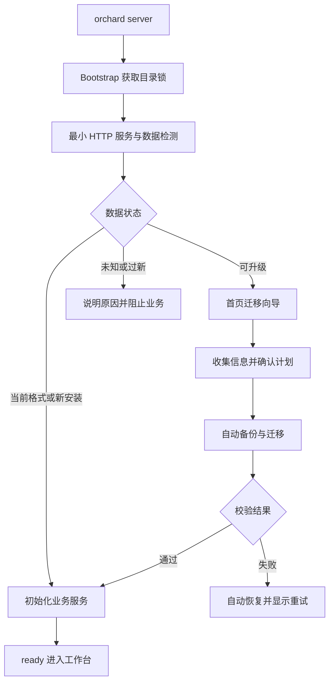

# 版本升级与数据迁移向导

- 状态：已完成；数据库审核已通过，开发、287 项自动化回归及最终构建/真实浏览器验收完成
- 创建日期：2026-11-06
- 最后更新：2026-11-06
- 范围：通过 `orchard server` 启动的本地工作台，包含数据库、应用配置和关联文件的版本迁移
- 实施状态：开发与验收完成；进度见 [任务清单](./tasks.md)，已完成检查见 [验证记录](./verification.md)，批准记录见 [审核材料](./schema-review.md)。完整交付仍须完成全部验收场景，真实场景验证留在最后
- 数据库审核：本方案不新增业务表或索引；迁移框架及每个涉及表结构的迁移包，实施前均须按根目录 `AGENTS.md` 审核

本文确定完整产品行为、首批迁移、持久化协议、接口与测试要求。常规实现不再等待产品选项确认。数据库审核仍是独立前置条件：补齐规格不代表审核通过，已有代码也不代表对应 SQL 已获授权。本次范围已由用户于 2026-11-06 明确确认，原始候选摘要与审核记录见第 11 节和审核材料。

## 1. 目标与体验

用户更新 Orchard 后，仍然通过原有 `orchard server` 命令启动。服务自动识别当前数据是否需要升级；打开首页时弹出“升级数据”向导，告诉用户需要改变什么，并集中收集确实需要用户确认或填写的信息。用户点击一次“确认并迁移”后，系统自动完成备份、转换、校验和服务启用。

用户不需要运行 SQL、编辑 JSON、查找备份目录或按照多个版本逐次升级。没有歧义的数据转换由系统处理；只有无法可靠推断的选择才进入表单。

首期采用启动时迁移、迁移期间暂停业务的模式。迁移成功后在同一服务地址进入工作台，不要求用户重启服务。失败时保留向导，由系统恢复迁移前状态，并提供重试入口。

## 2. 当前实现与问题

以本方案编写时工作区代码为准：

| 位置 | 当前行为 | 本需求需要解决的问题 |
| --- | --- | --- |
| `src/cli/index.ts` | `orchard server` 启动 `server/main` | 保持用户启动方式不变 |
| `src/server/main.ts` | 先构造 `Store`，再创建应用并监听 HTTP | 数据库打不开或迁移失败时，首页没有机会展示原因 |
| `src/persistence/store.ts` | 构造函数中加锁、创建或升级数据库、清理 staging、执行恢复 | 检测、迁移与业务启动耦合，用户无法预先确认 |
| `src/persistence/schema.ts` | 当前 `SCHEMA_VERSION = 6`，包含 v1 → v6 增量 SQL | 保留已存在的转换逻辑，统一交给迁移执行器调度 |
| `src/web-bridge/config.ts` | 加载 `config/web-bridge.json`，缺省字段通过合并补齐 | 尚无独立配置版本，也没有和数据库绑定的恢复边界 |
| `src/providers/registry.ts` | Provider 配置保存在 `provider_settings.config_json`；注册 Provider 时可能写入默认配置 | 配置迁移也需覆盖数据库中的 JSON；迁移前不能初始化业务组件 |
| `src/web/App.tsx` | 按 URL 直接挂载业务页面 | 需要在业务组件请求数据之前检查服务状态 |

需求提出时已有数据库升级前备份、事务和部分校验，但数据库与文件配置尚未形成统一的迁移计划；现已由独立 Bootstrap 与 worker 统一执行。

另外，`Store` 当前明确拒绝旧 `orchard.db` 和特定旧数据目录，包括默认 `~/.orchard` 的目录判断。本 feature 将路径黑名单改为第 5.1 节的数据身份判定：允许在默认路径使用经识别的工作台数据，仍拒绝旧产品数据和混合目录。不能通过忽略数据库身份或自动换一个空目录，使用户误以为原数据已迁移。

## 3. 范围与边界

首期包含：

- 启动检测、首页弹窗和独立 `/migration` 页面；深链接访问也经过相同检查。
- 支持已登记版本之间跨多个版本的连续升级。
- SQLite 表结构、业务数据、数据库内 JSON 配置和数据目录内应用配置文件的转换。
- 自动备份、持久化进度、中断识别、自动恢复、重试和诊断报告。
- 数据版本高于程序版本、未知数据格式、缺少迁移路径时的阻止和解释。
- 新安装初始化：确认目录为空后直接创建当前格式，不弹迁移向导。

首期不包含：

- 服务运行中的在线迁移、多实例共享数据库、远程数据库迁移。
- 导入旧 Orchard 产品数据库、合并多个数据目录、降级转换。
- 修改用户的全局 Codex/Pi 配置、浏览器登录状态或其他应用的数据。
- 从页面上传或执行任意 SQL、脚本和迁移插件。

只有随发布包提供、经过评审的迁移才能执行。运行时用户确认是对当前数据执行升级的授权，不能替代开发阶段的数据库结构审核。

首批实际转换固定为数据库 v1～v5 → v6，以及现有无版本浏览器桥接配置 → v1。Provider JSON、本地 Agent 会话和历史产物本次只校验并保留，不新增业务字段，不引入浏览器环境重绑定。通用表单能力必须交付，并以测试迁移验证；不得为演示表单而给真实数据增加必填项。

## 4. 用户流程

### 4.1 启动与入口

1. 用户运行 `orchard server [--data-dir <dir>]`。
2. 服务取得数据目录独占锁，启动最小 HTTP 服务并进行数据检测。终端输出访问地址和“数据待升级”等状态。
3. 浏览器先读取启动状态；检查完成之前只展示加载界面，不挂载工作流、脚本库、设置等业务组件。
4. 无迁移需求时进入原页面；需要迁移时，在首页展示全屏遮罩向导。其他 URL 使用同一向导，保留原访问地址。
5. 用户可收起弹窗查看升级说明页，但业务功能保持禁用，页面保留“继续数据升级”入口。刷新或重新打开页面后自动恢复向导。

“以后再说”不代表可以跳过结构迁移。可以停止服务并保留原数据；确认之前不会执行升级写入。

### 4.2 向导步骤

| 步骤 | 展示内容 | 用户操作 |
| --- | --- | --- |
| 升级说明 | 当前与目标数据版本、数据目录、变更摘要、受影响配置、自动备份说明 | 阅读后继续 |
| 确认信息 | 不能自动推断的必填项、带建议值的选择项，以及选择的影响 | 按需填写；无问题则省略此步 |
| 确认并迁移 | 汇总待执行变更、填写结果和备份策略 | 点击一次“确认并迁移” |
| 执行中 | 备份、转换、校验、启用的当前步骤、已完成步骤和耗时 | 等待，可关闭浏览器 |
| 完成 | 升级结果、备份位置、配置变更摘要 | 点击“进入工作台” |

执行进度以真实步骤呈现；无法计算准确进度的步骤显示处理中和已处理数量，不展示虚构的百分比或预计完成时间。

执行前允许返回修改。执行中不提供强制取消按钮；关闭浏览器不影响后端任务。服务进程中断时由下次启动恢复。

### 4.3 哪些信息需要用户填写

迁移步骤声明表单字段，系统从旧值生成建议：

- 字段改名、增加有明确默认值的字段、已知枚举映射：自动完成，只列入摘要。
- 旧配置能唯一确定目标值：自动填充，不要求再次输入。
- 一项旧设置对应多个目标环境：列出候选项、旧值和推荐理由，请用户选择。
- 新版本必须提供但旧数据不存在的信息：请求填写，并在前端和服务端校验。
- 可选功能需要额外信息：允许选择“暂不启用”，不阻止核心工作台升级。
- 无法无损转换的业务内容：明确列出影响并阻止执行，或者由该迁移包提供经过评审的保留策略；不能静默删除或猜测。

示例：某次发布将浏览器环境地址拆分为“环境名称”和“origin”。能从原地址解析出的 origin 自动迁移，缺少的环境名称可使用建议值；若一个旧配置需要选择绑定的目标环境，只让用户选择该环境。此例用于说明交互，不表示本次已经确认要修改浏览器配置。

## 5. 启动架构



职责划分：

| 模块 | 责任 |
| --- | --- |
| Bootstrap | 目录解析、锁、最小服务、生命周期状态、恢复未完成迁移 |
| MigrationRegistry | 内置迁移清单、依赖关系、版本路径与摘要 |
| MigrationPlanner | 只读识别源数据、生成计划、收集问题、计算计划摘要 |
| MigrationRunner | 重新校验计划、备份、执行、校验、记录进度、失败恢复 |
| BusinessServices | 仅对当前格式打开 Store，初始化 Provider、Runner、Bridge 等 |
| MigrationGate / MigrationWizard | 先检查启动状态，再展示业务页面或迁移向导 |

`Store` 构造函数最终仅接受已验证的当前格式及 Bootstrap 提供的有效锁租约，不能再隐式升级、创建新库或独立取得、释放目录锁。新库创建由 Bootstrap 明确调用初始化流程。现有 `recover()`、staging 清理、Provider 默认配置写入、ScriptAgent 日志恢复和业务任务恢复，全部延后到数据就绪之后，由业务初始化流程显式调用。

最小 HTTP 层不依赖 Store、Provider 或配置加载器，只依赖目录锁、迁移模块、静态资源和独立的本地认证设施。迁移前不启动浏览器桥接 socket、模型探测、排队任务和脚本维护。

业务路由使用同一个应用服务容器，在 `ready` 前统一拒绝访问；成功后初始化并切换容器。避免 HTTP 监听后动态重复注册路由。若业务初始化失败，保持业务不可用并报告启动错误；不得把“数据库迁移完成”当成“工作台已经就绪”。

### 5.1 数据目录判定

默认目录保持生产 `~/.orchard`、开发 `<cwd>/.orchard`，显式 `--data-dir` 优先，不引入静默回退目录。先解析目录真实路径，在创建锁、`runtime/` 等框架文件前记录原始目录清单；取得锁后重新核对。检测时只打开已经存在的数据库，只读连接不得隐式创建主文件或切换 journal 模式。

按以下顺序判定，命中后不再尝试其他初始化策略：

| 目录内容 | 判定及动作 |
| --- | --- |
| 存在不可识别的迁移协议、未完成任务或初始化记录 | 优先解析协议并恢复；未知协议进入 `blocked`，不按空目录处理 |
| 存在 `orchard.db`，包括与 `workbench.db` 并存 | `OLD_DATA_DIRECTORY` / `MIXED_DATA_DIRECTORY`；保留全部数据，不导入、不新建库 |
| 存在 `workbench.db`，身份为 `1331110449`、版本为 1～6、结构匹配对应基线 | 有效工作台；按版本和配置生成计划，与目录名称无关 |
| 存在 `workbench.db`，身份不符、版本为 0、版本过新、文件损坏或结构不匹配 | 对应 `UNKNOWN_DATABASE`、`DATA_VERSION_TOO_NEW`、`DATABASE_CORRUPT` 或 `SCHEMA_MISMATCH`；不得重建 |
| 原目录不存在或确实为空 | 新安装；显式初始化当前格式，无升级向导 |
| 没有数据库，但存在配置、产物、Agent 会话、旧备份或其他未知内容 | `INCOMPLETE_DATA_DIRECTORY`；不把残留数据当作新安装 |

框架生成的锁、会话 token 和已验证完成的初始化记录不影响首次初始化的判空；排除依据是本次原始目录清单和有效协议记录，不能只按文件名无条件忽略。文件和受控目录中的符号链接、特殊文件、资源路径越界一律阻止处理；不跟随链接复制或恢复。合法工作台目录内的未知文件列入诊断，但不删除、不迁移；未知配置文件按第 8.2 节原样备份。

### 5.2 锁与生命周期

Bootstrap 从检测开始到 HTTP 关闭、worker 结束、业务连接全部关闭后才释放锁。worker 使用主进程租约，不再次构造 Store 争锁。获取锁竞争必须失败即退出；旧 PID 锁的回收需确认进程不存在，并防止并发回收删除其他实例的新锁。PID 仍存在、锁内容损坏或无法证明所有权时保守拒绝，不自动抢占。释放时核对锁所有权。实现须通过双进程并发和陈旧锁回收竞争测试。

关闭服务时先拒绝新的写操作；迁移 worker 若能在当前安全边界内结束则等待，否则终止并保留阶段记录，下次按恢复协议处理。任何情况下都先停止 worker，再释放目录锁。业务服务部分初始化失败时，逆序关闭已经创建的组件、定时器和连接，锁与最小 HTTP 服务继续保留。

### 5.3 新安装与缺失可选配置

新安装在 `initializing` 下进行，先持久化 `migrations/initialization.json`，记录 `formatVersion: 1`、目标格式和仅由此次初始化创建的资源。于 `runtime/initialization/<id>/` 创建、校验并刷新当前数据库及 v1 默认配置，再安装到正式位置；安装全部完成后标记 `committed`。中断后只依据记录处理本次资源，不能删除来源不明的文件；已安装资源摘要不符时阻止启动。完成后建立初始账本，不生成迁移 job，不弹向导。

有效工作台仅缺少 `config/web-bridge.json` 时属于已登记的可选资源缺失，不等于损坏：默认值固定为第 6.5 节的空 v1 配置。若同时有迁移任务，在同一任务的工作副本中创建，纳入安装和恢复清单；若没有迁移需求，由 Bootstrap 通过同样的初始化记录协议单独创建，不打开业务配置加载器补写。现有文件即使为空文件或无效 JSON，也不得套用缺失默认值。

初始化记录阶段为 `preparing → prepared → installing → committed`，包含 kind（new_install / optional_config）、资源原始存在性、临时及目标摘要和安装进度。prepared 之前禁止替换正式文件；中断于 preparing 时清理已登记临时项并重新准备，中断于 prepared/installing 时校验临时或正式目标并幂等完成安装，不能重新判空。prepared 前必须落盘全部可重放的目标和摘要；临时文件丢失而正式目标未安装时，只能重新生成能核验为同一目标的资源，否则阻止。committed 后不按旧摘要检查已可编辑的数据。账本建立使用同目录临时写入和刷新协议；初始化 committed 与账本之间中断可按记录幂等补齐。可选配置初始化只能创建这一个原本不存在的文件，不能修改既有数据库。

## 6. 版本与迁移计划

### 6.1 版本模型

区分以下版本，不能只比较 npm 包版本：

| 维度 | 记录方式 | 说明 |
| --- | --- | --- |
| 数据库结构 | 现有 `PRAGMA user_version` | 延续当前版本号；本设计不预设下一个结构版本 |
| 数据库身份 | 现有 `PRAGMA application_id` | 识别是否为受支持的工作台数据库 |
| 文件配置格式 | 对应配置中的 `schemaVersion` | 每类配置独立演进 |
| 数据转换记录 | 文件迁移账本中的稳定 migration ID | 覆盖不改变表结构的 JSON 或业务数据修正 |
| 应用版本 | 发布包版本或构建标识 | 展示与诊断使用，不单独决定是否迁移 |

没有 `schemaVersion` 的配置，只有匹配第 6.5 节旧格式识别规则时才识别为 baseline v0；完整匹配指通过识别器，不要求历史可省略字段全部存在。不能把所有无版本 JSON 都当作合法旧配置。首次引入配置版本是显式迁移步骤；配置缺失按第 5.3 节初始化。

数据库内 `provider_settings.config_json` 的转换记录使用 migration ID，不要求为了迁移框架新增业务列。配置的业务 `revision` 按原有并发约定更新，避免覆盖后续设置。

### 6.2 迁移声明

每个内置迁移至少声明：

| 字段或能力 | 约定 |
| --- | --- |
| `id`、`checksum` | 稳定唯一 ID 和发布时内容摘要；已经发布的迁移不可原地修改 |
| `requires`、`from`、`to` | 前置步骤、源与目标版本，建立唯一可验证的执行路径 |
| `summary`、`affectedResources` | 面向用户的说明和精确资源清单 |
| `inspect` | 只读检测适用性、数据量、冲突和空间需求 |
| `questions` | 字段类型、默认值、必填条件、约束和敏感标记 |
| `apply` | 在执行器提供的上下文中完成转换 |
| `verify` | 校验结构、配置、引用关系和业务不变量 |
| `reviewReference` | 涉及表结构时关联审核结论 |

迁移按固定顺序执行，首期不并行。升级链中的所有问题在执行前汇总，字段用 migration ID 隔离。后一步的问题若依赖前一步结果，规划器在临时副本中推演，不能先修改原数据再让用户补填。答案改变后重新推演并重算确认摘要；缺少前置答案时返回 `needs_input` 和可回答的问题，禁止提交执行。所有问题确定、计划推演通过后才允许最终确认。

计划包含源状态指纹、目标版本、执行顺序、迁移摘要、问题定义和空间估算，并计算 `planHash`。确认请求携带该摘要和答案；服务端重新检测源状态。数据、迁移包或答案发生变化时，返回新预览，旧确认失效。

### 6.3 跨版本与兼容规则

- 当前已知数据库 v1～v5 可组合现有增量 SQL 升至 v6，前提是对应迁移已审核且校验通过。
- 原始 SQL 中的版本更新应由统一执行器协调；数据库记录只能说明数据库步骤完成，不能代表配置转换也完成。
- 只改配置、不改数据库的发布，同样产生迁移计划和首页引导。
- 缺少中间版本迁移、同 ID 摘要变化、数据库过新、配置过新或身份不匹配时阻止执行。
- 未登记在迁移清单中的数据修正不能在普通配置读取或业务启动时偷偷执行。

### 6.4 首批迁移清单与账本基线

以下 ID 固定，不按应用版本重新命名。数据库步骤严格按源版本选择余下链条，配置步骤最后执行；本批步骤都没有用户必填项。

| 稳定 ID | 适用条件与结果 | 实际转换及校验 |
| --- | --- | --- |
| `db.v1-v2` | 数据库 1 → 2 | 冻结现有 `MIGRATE_V1_TO_V2`；重建 runs，保留旧行，新增草稿运行列为 NULL；核对索引、行数和引用 |
| `db.v2-v3` | 数据库 2 → 3 | 冻结现有 `MIGRATE_V2_TO_V3`；新增会话、轮次/消息关联和索引；旧关联保持 NULL，submission_state 为 not_sent |
| `db.v3-v4` | 数据库 3 → 4 | 冻结现有 `MIGRATE_V3_TO_V4`；archived → idle，title 为 NULL，原 archived 的 archived_at 取 updated_at；验证唯一 current 和自引用 |
| `db.v4-v5` | 数据库 4 → 5 | 冻结现有 `MIGRATE_V4_TO_V5`；新增 scripts、script_versions、script_tests 及对应索引、触发器，旧业务行不变 |
| `db.v5-v6` | 数据库 5 → 6 | 冻结现有 `MIGRATE_V5_TO_V6`；timeout_ms 默认 300000，约束为 1000～300000，原有已发布版本内容不变 |
| `config.web-bridge.v0-v1` | 已存在的合法无版本配置 → v1 | 按第 6.5 节增加 schemaVersion 并补齐顶层空映射，其余值与未知字段保留 |

实现时将当前 SQL 的实际展开字符串冻结进迁移资源；`RUN_SCHEMA` 等插值必须展开，不再依赖可变的当前 Schema 常量。checksum 为 SHA-256，覆盖规范化声明、精确 SQL 字节、转换实现及其本地依赖、目标校验器、问题定义。构建生成清单并与纳入评审的锁定清单比对，禁止启动时重新计算后直接信任变化后的值。同一 ID 内容改变必须让检查失败；修复已发布步骤应发布新 ID 和明确的兼容路径。

账本 `formatVersion: 1`，包含 `baseline` 和按 job 分组的 `completed`。baseline 保存首次接管时已验证的数据库身份、版本、配置版本及来源，不伪造旧 SQL 的执行记录。已有 v6、配置 v1、无账本的目录在只读校验通过后可直接初始化账本，不要求无意义的升级确认；已有 v6、配置 v0 的目录只计划配置步骤。已有 v1～v5 则从真实源版本起执行；完成记录和源版本矛盾时阻止启动。

账本丢失时，可由完整且受支持的 committed 任务记录重建；不存在任务的历史工作台允许建立 baseline；存在任务但账本丢失、任务不完整或摘要矛盾时，不把它当作从未迁移。校验历史 checksum 使用发布包保留的清单档案。未来发布仍须保留对本协议和已有 ID 的识别能力。

### 6.5 浏览器桥接配置 v0 → v1

目标默认内容：

```json
{
  "schemaVersion": 1,
  "applications": {},
  "environments": {},
  "tools": {},
  "enabledTools": {}
}
```

旧格式识别、转换和目标校验规则：

1. 必须是合法 JSON 的普通对象，不能是 null、数组、原始值或空文件。无 schemaVersion 的空对象 `{}` 是合法 v0；非空对象至少包含四个已知顶层字段中的一个。仅有未知键不能认定为旧配置。
2. 四个已知顶层字段均可缺失，缺失时补 `{}`；已存在时必须为对象，不能把 null、数组或错误类型替换成默认值。显式 schemaVersion 仅接受整数 1；其他值按未知或过新格式阻止，不当作无版本配置。
3. applications 的每项保留 id、name、enabled，验证键与 id 一致、前两者为非空字符串、enabled 为布尔值。environments 的每项为数组，环境记录按现有 `WebBridgeEnvironment` 校验 id、origin 字符串和 enabled、bound、tabAvailable 布尔值，profileId、extensionId 可缺失；origin 按现有保存规则校验，id 在应用内唯一。
4. tools 每项按现有 `WebBridgeTool` 的字段和枚举校验：字符串身份及说明、JSON Schema 对象 parameters、同源绝对路径 path、GET/POST method、字符串数组 fields、risk 与 approval 枚举、100～120000 的 timeoutMs、catalogVersion 和 enabled。映射键须等于 `application/toolId`。enabledTools 的值必须是布尔值。缺失的嵌套必需字段不猜测补值。
5. environments、tools 的应用引用必须存在，enabledTools 的键必须为合法的 `application/toolId`；允许对应工具尚未登记的开关值，保留其原意，不据此删除。profileId、extensionId 是外部引用，只保留，不连接浏览器验证。
6. 转换只添加 schemaVersion 和缺失的顶层映射。所有已存在的已知值及各层未知 JSON 字段按值原样保留，拒绝重复 JSON 键以免解析歧义；使用安全的键访问，不让 `__proto__` 等键改变对象原型。换行和缩进可变，不要求原字节一致。
7. v1 加载和保存共用目标校验器，普通读取不再做无版本补齐；保存不能丢失未知字段。非法配置阻止迁移并给出字段路径、错误码，不把配置原文写入报告。不存在的配置按第 5.3 节处理。

本批不重命名环境、不修改绑定、不新增 Provider 设置、不调用浏览器或模型。历史 v0 部分配置样本与 v1 样本必须纳入版本化夹具。

### 6.6 指纹、摘要与问题契约

数据库指纹取只读一致性事务内的身份、版本、结构和全部业务表内容摘要；按稳定表名、列序及主键排序，无主键表按规范编码的行排序，值编码区分 NULL、整数、实数、文本与 BLOB。非数据库资源按相对路径排序，记录存在性、类型、权限、长度与内容 SHA-256。不把 mtime、运行时 token、WAL/SHM 的物理字节或任务记录纳入业务指纹。checkpoint 前后业务内容相同应产生同一指纹。

所有大规模扫描、数据库校验和副本推演在 worker 中执行。扫描期间发现外部写入、文件变化或稳定性无法确认则终止本次规划，返回 `SOURCE_CHANGED`，不拼接多个时刻的数据。数据库快照和文件扫描完成后重新核对源状态；确认前和正式安装前均校验源指纹，工作副本的源应与已确认指纹一致。外部修改导致不一致时拒绝安装，保留原数据并要求重新规划；目录锁只约束遵守协议的 Orchard 实例，不宣称阻止任意外部程序写文件。

`planHash` 是版本化规范 JSON 的 SHA-256，包含数据目录身份、源指纹、目标格式、迁移 ID/checksum 顺序、资源范围、问题定义和答案推演出的计划分支；不含时间戳、轮询计数和答案秘密。JSON 键按 UTF-8 字节序排序，不能依赖系统 locale。`confirmationHash` 使用进程内随机密钥 HMAC-SHA-256，绑定当前会话、planHash、规范化后的全部答案和最终摘要；避免公开秘密答案的裸摘要。摘要不持久化秘密答案到公开状态。确认有效期 30 分钟，进程重启或答案改变后必须重新 validate。

问题类型支持 string、secret、boolean、enum、integer，字段键为 `<migrationId>/<fieldId>`，包含 label、description、required、default、约束和选项。服务端拒绝未知字段、非法枚举和无效条件分支；前端复用同一公开定义校验。敏感字段只返回是否已提供，不返回旧值、默认秘密或提交回显；失败后要求重新输入。真实首批迁移不需要这些问题，专项测试用内置测试夹具覆盖全部类型、条件问题和前置答案变化，测试迁移不进入发布包。

## 7. 状态与持久化

应用状态与任务阶段分开记录，HTTP 和页面以应用状态决定可用操作：

```text
checking → initializing → ready
checking → migration_required → migrating → verifying → installing → initializing → ready
checking → restoring → failed
checking → blocked / recovery_required
migrating / verifying → failed
installing → restoring → failed
restoring → recovery_required → restoring
initializing → initialization_failed → initializing
failed → migration_required → migrating
```

服务重启后若发现未完成记录，按第 8.3 节的阶段决策处理，不能见到未完成任务就尝试恢复不完整备份。`failed` 表示正式数据保持或恢复到迁移前一致状态，`recovery_required` 表示系统尚不能确认一致性，两者均不能进入业务。失败后只读重新规划，有效计划准备好才提供重新确认入口。

| 应用状态 | 可执行操作 |
| --- | --- |
| checking | 查询检测进度，不可提交任务 |
| migration_required | 预览、填写、validate、创建一个任务 |
| migrating / verifying / installing / restoring | 查询当前任务、下载已有报告，不可重复执行或强制取消 |
| failed | 查看失败结果、重新规划和确认后 retry |
| recovery_required | 查看诊断、recover；禁止普通迁移重试 |
| initializing | 查询启用进度，业务保持禁用 |
| initialization_failed | 查看错误、重试业务初始化；不得重新迁移或自动回滚 |
| blocked | 查看原因和诊断；修复原因并重启检测，不能点击跳过 |
| ready | 开放业务、查看脱敏历史迁移结果；拒绝创建迁移任务 |

内部任务阶段固定为 `accepted → backing_up → backup_complete → transforming → verifying → prepared → installing → installed → committed`；安装前失败进入 `failed`，安装后失败进入 `restoring → restored`，恢复未完成进入 `recovery_required`。`restored` 对应应用 `failed`。任务提交成功与业务初始化结果分别保存：任务 committed 后即使业务初始化失败，也不能把任务改成迁移失败。

在数据目录新增以下文件布局，不新增数据库表：

```text
migrations/
  ledger.json
  private-key
  initialization.json
  operations/<operationId>.json
  jobs/<jobId>/state.json
  jobs/<jobId>/install.json
  jobs/<jobId>/events.jsonl
  jobs/<jobId>/private-input.json
runtime/migrations/<jobId>/
  work/
  install/
backups/migrations/<jobId>/
  manifest.json
  snapshot/
```

账本保存 baseline、已完成迁移 ID、摘要、源/目标版本和完成时间。任务状态保存 formatVersion、jobId、attemptOf、requestId、私有请求摘要、计划摘要、源指纹、目标格式、备份引用、当前阶段、步骤计数、恢复阶段、错误码、时间和单调递增 revision。所有路径均为受控相对路径，API 不接受客户端指定。安装清单保存每项资源安装前存在性、备份摘要、目标摘要及替换进度；任务保存执行前账本的存在性和完整副本，以便撤销本次变更而保留历史记录。

事件日志用于展示，状态文件与实际资源校验才是恢复依据；最后一条未完整写入的日志可以舍弃。API 返回的公开视图不直接序列化内部状态或日志原文。

关键状态通过同目录临时文件写入、刷新、rename 和目录刷新持久化。目录权限 `0700`，文件权限 `0600`。敏感答案仅在必要的私有任务文件中保存，完成或恢复后删除；不进入日志、账本、公开进度和诊断报告。若不适合持久化某项秘密，重试时重新填写。

迁移框架文件使用独立 `formatVersion`。程序无法识别账本或恢复协议时应阻止启动，不能误判为未发生过迁移。

private-key 为目录首次由框架接管时生成的 32 字节随机密钥，权限 0600，仅用于持久化请求摘要的 HMAC，不是浏览器 token。密钥丢失但仍有依赖它的请求回执时阻止新写操作并报告，不能重新生成后错误匹配历史请求。初始化、账本建立和私有密钥创建属于明确登记的框架元数据操作，不代表允许自动迁移业务数据。

## 8. 自动执行、备份与恢复

### 8.1 执行顺序

1. 校验确认请求、必填项、`planHash`、源状态指纹和目录锁。
2. 检查目录可写、存储空间与资源完整性；未通过时保留表单，不开始转换。
3. 持久化已接受任务和去重信息后才返回 202；worker 生成完整迁移前快照，备份文件、清单和目录均刷新并校验通过后持久化 `backup_complete`。
4. 在快照的独立工作副本中执行数据库和配置转换；迁移脚本只能访问声明的资源。
5. 对工作副本执行数据库完整性、外键、配置格式、业务不变量及引用校验。
6. 源状态再次校验通过，准备正式位置同文件系统的安装临时文件及完整清单，落盘 `prepared`。关闭相关连接，先持久化 `installing`，再将目标资源逐项安装到正式位置，每项替换后刷新资源和父目录并更新进度。
7. 校验正式位置并落盘 `installed`，原子写入带本任务条目的完成账本，刷新后持久化 `committed`；清除敏感输入，保留备份和脱敏任务结果。
8. 初始化业务组件并进入 `ready`；页面展示结果。

迁移应通过异步任务或独立 worker 执行，避免同步 SQL、复制大目录阻塞 HTTP 状态查询。worker 的退出和错误由主进程接管，不能因浏览器断线终止。

首期允许额外的磁盘开销来换取恢复确定性。空间检查覆盖备份、工作副本、安装临时文件和迁移声明的增长预留；空间耗尽仍按可恢复失败处理，不能仅依赖预估。

### 8.2 快照边界

持久资源注册表在首个发布包中完整列出以下项目，禁止以实现时再补充的兜底项代替：

| 资源 | 备份与本批处理 |
| --- | --- |
| `workbench.db` | 备份数据库；转换 Schema，保留 Provider JSON、工作流、运行与对话业务内容 |
| `config/` | 全目录备份；仅转换 web-bridge.json，其他文件原样保留，不加载未知配置 |
| `artifacts/` | 全量备份并保持字节；校验数据库中的树、blob、源码和草稿快照引用 |
| `runs/` | 全量备份并保持字节；保留历史运行目录和输出 |
| `script-agent/` | 全量备份并保持字节；包含生成历史、提案、快照和请求去重信息 |
| `agent-sessions/` | 全量备份并保持字节；包括本地 Pi 会话文件，不启动 Pi 验证 |
| `agent-workspaces/` | 全量备份并保持字节；保留原生会话使用的 cwd，不为了迁移重建为空目录 |

快照记录资源是否存在，以及每个文件的相对路径、类型、大小、摘要、权限和格式版本。空目录也记录；恢复需要保留原本不存在这一事实。数据库中的绝对本地会话路径在副本校验时映射到快照资源读取，不写回临时路径；安装后仍指向原数据目录。Codex 等在目录外管理的会话只保留原引用，不复制外部应用文件；报告说明此类资源不属于自动备份范围。

排除 `workbench.lock`、`runtime/`、可重建 staging、迁移工作副本和备份目录自身。`migrations/` 不整目录回滚；其中账本以任务专用副本恢复，其他任务记录、回执和诊断证据保留。迁移不得修改快照边界外的持久数据；新增资源类型时必须补充注册表。认证 token 等运行态资源不从备份覆盖运行中的 token。

完整快照与安装范围分开：所有登记资源都备份，但安装清单只包含声明会修改的数据库、配置和明确新增资源，未修改目录不反复复制安装。首批迁移不重写 artifacts、runs、script-agent、agent-sessions、agent-workspaces。恢复仅还原安装清单的资源，随后核验整个快照边界与迁移前一致，不擅自覆盖检测到的外部修改。

备份数据库前先确认 WAL checkpoint 成功，再关闭连接复制，并验证备份完整性。不能直接复制处于写入状态的主数据库文件，也不能把 WAL/SHM 当作可独立恢复的快照。checkpoint 失败时拒绝开始迁移。

首期不自动删除完整迁移备份；界面展示实际占用和保留位置。部分备份永远不标为可恢复，失败后保留供诊断，并允许仅清理已登记为临时的工作副本。大规模数据的增量备份与保留策略不属于本次交付。

### 8.3 原子性与中断恢复

SQLite 事务不能覆盖多个 JSON 文件，因此不能将整个过程描述为“一个事务”。本方案通过业务隔离、备份、安装清单和恢复协议提供一致性：

- 备份完成前或副本转换失败：不进入正式安装，不从不完整快照恢复；清理任务临时资源并核验原始数据，状态为 failed。
- 正式安装中失败或重启：依据安装清单，从已校验快照恢复全部受影响资源，包括删除迁移新建而快照原本不存在的文件。
- 完成账本与 `committed` 之间崩溃：已进入 installing 且尚未持久化 committed 的任务一律恢复迁移前数据，并按账本专用副本撤销该任务的完成记录。
- 已持久化 `committed` 后重启：重新校验目标数据，通过后初始化业务，不重复迁移；不通过则阻止启动并提供诊断。
- 恢复过程自身被中断：下次按同一快照继续幂等恢复。备份损坏或空间不足导致无法恢复时进入 `recovery_required`，保留全部证据。

安装和恢复数据库前关闭连接，在独占控制下处理原 WAL/SHM，避免旧日志重新作用于恢复后的主文件。每项恢复完成都落盘并可重入；恢复完成后再次核对快照摘要和数据库状态。

完成后业务初始化失败时，可以重试初始化；不能在业务已经开放并产生新写入后，自动回滚到迁移前快照。后续运行错误按普通运行故障处理。

持久化阶段的重启处理固定如下；某一步实际完成但标记尚未落盘时，按更早的持久化阶段处理：

| 最后持久化阶段 | 正式资源是否允许被替换 | 重启后的唯一处理 |
| --- | --- | --- |
| accepted / backing_up | 否 | 核验原数据，任务失败；完整快照标记不存在时不得恢复 |
| backup_complete / transforming / verifying / prepared | 否 | 核验原数据、结束旧尝试，重新规划并要求确认；不自动重跑转换 |
| installing / installed，含账本已写但 committed 未落盘 | 是 | 验证备份和清单，幂等恢复全部安装项及账本，核验后标记 restored |
| restoring / recovery_required | 可能已恢复部分 | 从恢复清单继续，不能执行普通 retry；证据不足则保持 recovery_required |
| restored / failed | 不再修改 | 保留结果、重新规划；由用户重新确认创建新尝试 |
| committed | 已提交 | 按当前发布目标和账本校验兼容性，通过后初始化业务；不能恢复旧快照 |

恢复前逐项核对正式文件属于已记录的迁移前值、目标值或受控恢复临时值；出现未知内容、清单缺失、备份损坏、I/O 错误或空间不足时进入 recovery_required，禁止自动覆盖未知数据。恢复某项时先从快照复制到正式位置同目录的恢复临时文件，刷新并验证后 rename，刷新目录再标记该项完成；重入时再次核验已完成项。删除原本不存在的新增文件也必须刷新父目录。全部恢复完成并且账本恢复后才可落盘 restored。

数据库工作副本校验后也须 checkpoint、关闭连接并刷新主文件，才能准备安装；不能只处理源数据库的 WAL。用于备份与恢复的原始数据库主文件按备份摘要验证，源数据库指纹则按逻辑内容验证，避免 checkpoint 的物理变化被误判为数据丢失。

committed 后的首次正式资源校验在业务开放前可比对本任务目标摘要；业务开放后和以后重启，只检查当前格式、结构、业务不变量及账本路径，不再要求数据库或可编辑配置匹配迁移刚完成时的字节摘要。若未来发布需要继续升级，先识别上次已提交，再规划下一条迁移链，不能拿旧目标版本阻止合法后续升级。

### 8.4 业务初始化与重试

初始化按 Store 打开 → 业务恢复 → 配置与 Provider → 服务组件创建 → 容器就绪的顺序执行；任务调度器在容器全部创建成功且状态切换为 ready 后才开始消费队列。业务恢复可将中断状态落库，不能在其中重新执行业务脚本。创建失败必须先完成组件清理再显示 initialization_failed。

`POST /api/bootstrap/initialize` 仅在 initialization_failed 允许使用，创建一个受去重保护的异步初始化尝试；并发请求只返回同一活动尝试。初始化恢复操作需幂等，重复执行不得重复插入恢复事件或重复启动队列。数据已提交而初始化失败时保持 committed，重试只初始化；新安装初始化失败则按 initialization.json 区分尚未安装完成的数据初始化和已经完成的数据上的业务初始化。若无法证明清理完成则要求重启，不在同一进程叠加第二组组件。

### 8.5 校验规则

- 数据库身份、目标版本、完整性检查和外键检查均通过。
- 每个转换定义自身的不变量：标识、引用、历史状态、字段映射和数量关系。
- 不统一要求所有旧表行数不变；拆表或合表需要明确的数量与关联校验。无重组的现有迁移保留原行数检查。
- JSON 配置严格验证目标格式，未知字段按迁移声明保留或明确处理，不静默清空。
- 原本有效的产物引用在迁移后仍可读取；历史不可变产物默认保持原字节，通过读取适配兼容。确需重写时生成新摘要并更新全部引用。
- 校验过程不能启动用户脚本、调用外部模型或执行业务网络请求。

## 9. 接口与访问控制

以下为拟定接口，均由最小 HTTP 层提供：

| 接口 | 用途 |
| --- | --- |
| `GET /api/bootstrap/session` | 通过同源握手获取迁移专用会话 token；不依赖 LocalApiAuth、Store 或业务配置 |
| `GET /api/bootstrap/status` | 返回应用状态、是否可进入业务、当前任务 ID 和可执行操作 |
| `POST /api/bootstrap/initialize` | 初始化失败后重试，提交 requestId，返回 202 和 initializationAttemptId |
| `GET /api/migrations/plan` | 返回只读预览、问题定义、`planHash` 和阻止原因 |
| `POST /api/migrations/validate` | 校验答案并返回最终摘要、`confirmationHash`；不修改业务数据 |
| `POST /api/migrations/jobs` | 提交 `requestId`、`planHash`、`confirmationHash`、答案，确认并执行；返回 202 |
| `GET /api/migrations/jobs/:jobId` | 查询持久化进度和结果，首期通过轮询恢复页面 |
| `POST /api/migrations/jobs/:jobId/retry` | 已恢复失败任务生成新执行尝试，必须重新验证当前计划和确认信息 |
| `POST /api/migrations/jobs/:jobId/recover` | 对 `recovery_required` 任务重试自动恢复，不能绕过校验 |
| `GET /api/migrations/jobs/:jobId/report` | 下载去敏后的诊断报告 |

所有会产生执行尝试的写请求使用请求标识去重：同标识、同内容返回同一结果；同标识、不同内容返回 409。`validate` 是无持久化副作用的计算请求，不分配执行回执。请求回执保存在独立迁移状态中，不能依赖尚未升级的 `command_receipts` 表。多个标签页只能创建一个活动任务，重复进入时订阅同一任务。

迁移接口校验本地 Host、精确同源来源、JSON 内容类型和启动会话 token，按第 9.2 节执行。恢复路径和备份路径由服务器登记，客户端只能提交任务 ID，不能提交任意文件路径。

`/api/health` 不应再依赖 Provider 或 Bridge：返回服务存活状态和 `ready`。增加 `/api/ready`，只有业务可用时返回 200，其余返回 503。迁移期间所有业务 API，包括读取接口，返回 503 和 `MIGRATION_REQUIRED` / `MIGRATION_IN_PROGRESS` 等明确错误码；未知接口保持正常 404。

错误响应包含稳定错误码、面向用户的解释和下一步操作。报告允许包含格式版本、迁移 ID、阶段、脱敏错误和资源校验摘要；不包含配置原文、token、完整数据库或用户业务内容。

### 9.1 请求、响应与幂等契约

接口 DTO 在服务端和前端共享；对象禁止未声明字段，requestId 为 1～200 字符，jobId 为服务端 UUID，planHash 与 confirmationHash 为摘要字符串：

| 接口 | 输入与关键输出 |
| --- | --- |
| status | 返回 `state, ready, revision, activeJobId, initializationAttemptId, actions, error`；actions 由服务端状态机生成 |
| plan | 完成时返回 `status: ready / needs_input / blocked, planHash, sourceVersions, targetVersions, steps, resources, questions, estimates, blockers`；计算中返回 202 和 `{status: checking, revision, retryAfterMs}`，客户端轮询，不能阻塞 HTTP 线程 |
| validate | 输入 `{planHash, answers}`；返回新的 planHash、脱敏 summary、fieldErrors、`confirmationHash, expiresAt`；仍缺答案时不签发 confirmationHash |
| jobs | 输入 `{requestId, planHash, confirmationHash, answers}`；成功 202，返回 `{jobId, state, statusUrl}` |
| retry | 输入与 jobs 相同；新 jobId，`attemptOf` 指向原任务，原任务结果不可覆盖 |
| recover | 输入 `{requestId}`；只对 recovery_required 启动同一任务的恢复尝试，返回 jobId 和 recoveryAttemptId，不重新执行转换 |
| initialize | 输入 `{requestId}`；只重试初始化，返回 initializationAttemptId；通过 status 查询结果 |
| job | 返回 `jobId, attemptOf, phase, revision, steps, processed, startedAt, updatedAt, result, error, actions`；result 区分迁移 committed 与业务 ready |
| report | 返回脱敏 JSON 附件，字段由白名单生成；路径中的用户目录前缀脱敏，不包含绝对会话路径或任意异常堆栈 |

服务端串行处理创建任务、重试、恢复、初始化的状态转换。创建任务必须在落盘 accepted 和请求身份后才返回 202，落盘前绝不启动 worker；接收后响应丢失，重发仍获得同一任务。accepted 任务自身是 jobs 请求回执的权威记录，索引可从任务重建，避免任务和回执双写导致重复执行。recover、initialize 使用 `operations/<operationId>.json` 保存 requestId、作用域、输入 HMAC、目标尝试和 accepted/result，先落盘再调度；重启识别 accepted 操作，按对应恢复或初始化协议收敛，不丢弃为“未执行”。

去重作用域为端点加目标任务，输入 HMAC 包含全部语义字段和敏感答案，但不包含传输会话 token；公开响应不返回该摘要。同 requestId 的既有回执优先于确认有效期检查，但仍需通过本次认证；因此进程重启后换 token，已接受的请求仍能返回原 job，不因旧确认失效而重复执行。新 requestId、旧确认则返回 `CONFIRMATION_EXPIRED`。不同 requestId 同时提交同一 planHash 和答案时返回已有活动 job；不同计划或答案则返回 `MIGRATION_BUSY`，不能创建第二个任务。

统一错误形态为 `{code, message, retryable, nextAction, fieldErrors?}`，不使用原始异常 message 直接向页面或报告输出。状态码固定：400 非法请求、401 无效 token、403 来源或 Host 拒绝、404 未知接口或任务、409 状态冲突/计划过期/请求冲突、422 答案校验失败、503 业务未就绪。已接受任务的磁盘、转换、恢复错误通过 job 状态返回，不把轮询变成持续 500。

validate/jobs/retry 发现源数据或迁移清单改变时返回 409 `PLAN_STALE`，不自动为新数据签发确认；客户端先重新取得预览并再次确认。validate 中仅答案改变造成的问题和分支变化可返回新 planHash；用户看到更新的最终摘要后才能提交。恢复失败和初始化失败由各自状态提供下一步，不复用 migration_required 掩盖区别。

前端默认每秒查询活动状态，空闲时每三秒；页面隐藏后降为每五秒，重新可见立即查询。以 revision 丢弃乱序响应，断线只停止展示更新，不发起新任务。只读计划的重复计算合并为单一活动计算，源状态变化或答案改变时使原计算失效。

### 9.2 Bootstrap 认证与同源规则

Bootstrap 每次进程启动在内存生成独立的 32 字节随机会话 token，供同一进程的多个标签页使用，不复用 `runtime/api-token`，不写入 URL、日志、localStorage 或迁移账本。`LocalApiAuth` 仍服务于现有业务用途，不能作为浏览器读取本地文件的替代办法。

浏览器先同源请求 `GET /api/bootstrap/session`，携带固定握手头 `X-Orchard-Bootstrap: 1`，使用 `credentials: same-origin`；响应 `{token, sessionId}`，设置 `Cache-Control: no-store`。端点要求本地 Host、正确握手头，并且浏览器 `Sec-Fetch-Site` 为 same-origin；无该 Fetch Metadata 头的客户端必须显式提供与请求服务 origin 完全一致的 Origin。拒绝 cross-site、same-site 和 none。没有 CORS 允许头，跨源 OPTIONS 预检直接拒绝，不能通过可跨站加载的脚本或图片取得 token。

所有迁移详情、计划、任务和报告请求均携带 `X-Orchard-Bootstrap-Token`；所有 POST 另外要求 `Content-Type: application/json` 和精确相等的 Origin。比较协议、主机和实际监听端口，不能只判断是否为 localhost；127.0.0.1 和 localhost 是不同 origin。若带 Sec-Fetch-Site 必须是 same-origin。Host 必须为已允许的回环主机与本次端口，禁止信任 forwarded 头构造 origin。

静态页、health、ready 和 status 的最小公开视图可无 token 读取；无 token 的 status 仅给状态、ready 和 revision，不给目录、任务详情、操作或错误内容。前端获取 token 后读取完整 status，再加载向导或业务组件。业务门禁只拦截已登记业务路由，不能把未知 API 的 404 改为 503。token 无效时先重新握手；对会产生任务的请求，必须沿用同一个 requestId 重发，不自动生成新标识。

迁移成功后仍可使用本会话 token 查看脱敏结果；它不自动授权现有业务 API。终端客户端如需调用迁移 API，也走同一握手、Origin 和 token 流程，无需读取用户文件。此机制不承诺抵御已经获得本机文件读取或同源脚本执行权限的进程。

## 10. 页面状态与异常处理

| 情况 | 页面反馈 | 系统行为 |
| --- | --- | --- |
| 没有迁移 | 正常进入目标页面 | 不展示向导 |
| 需要迁移但没有必填项 | 展示变更摘要与“确认并迁移” | 自动准备全部转换 |
| 填写不完整或格式错误 | 定位到具体字段 | 不创建执行任务 |
| 数据被外部修改 | 提示“数据已变化，请重新确认” | 重新生成计划，保留仍有效的非敏感答案 |
| 空间不足、目录不可写、备份失败 | 显示原因和重试按钮 | 不转换原数据 |
| 转换或校验失败 | 显示失败步骤、恢复状态和报告入口 | 自动恢复后允许重新确认并重试 |
| 服务中断 | 重新访问后显示恢复进度 | 先恢复一致性，再重新规划 |
| 版本过新或未知格式 | 显示实际版本、支持范围和目录 | 阻止业务；不清空或初始化原库 |
| 另一实例持有锁 | 终端说明已有实例 | 新实例退出，不启动第二个迁移服务 |
| 迁移成功但业务启动失败 | 显示 initialization_failed 和重试初始化入口 | 保留已提交数据，通过 initialize 接口重试，不重复执行转换 |

关闭向导、刷新、浏览器退出均不会清除后端进度。完成后用户可返回原深链接；若目标已不存在，则进入工作流首页并说明。

## 11. 具体代码与数据影响

新增 `src/migrations/`，包含 types、registry、planner、runner、backup、journal、resources、validators 和 worker；冻结 SQL 放在独立版本资源中。新增 `src/server/bootstrap.ts` 负责生命周期、锁和独立认证；前端新增启动状态门禁及迁移向导。`server/main.ts` 调整为 Bootstrap 启动，`server/app.ts` 拆出不依赖 Store 的外壳与延迟初始化的业务服务容器。核心算法、协议和校验器不依赖 React、Provider 或 HTTP 对象。

数据库与配置变更边界：

| 资源 | 本 feature 的计划 | 审核要求 |
| --- | --- | --- |
| 业务表、索引、约束 | 不新增、不删除；现有迁移转交执行器调度 | 迁移执行方式变更需评审；新 DDL 须单独列明并先审后实施 |
| `PRAGMA user_version` | 保持现有编号体系，由数据库步骤更新 | 与对应 SQL 一并审核 |
| `provider_settings.config_json` | 纳入迁移框架，具体字段变化由发布迁移声明 | 逐项评审字段映射与保留策略 |
| `config/web-bridge.json` | 增加 `schemaVersion: 1`，按第 6.5 节识别并转换无版本格式 | 按本文字段保留规则实施，不新增绑定或环境选择 |
| `migrations/` 与迁移快照 | 新增文件状态、回执和备份清单 | 评审恢复协议及敏感数据处理 |
| `artifacts/` 与 `runs/` | 默认备份并保留，不为了框架引入而改写内容 | 未来转换需声明引用校验 |

本方案没有给出任何新的业务 DDL。若实施时发现必须新增表、索引或调整字段，应先在本 feature 下补充具体结构和迁移 SQL 的审核材料，审核通过后才能操作。

### 11.1 数据库审核材料与真实状态

本次评审申请范围为：把现有 v1 → v6 SQL 冻结后交给副本执行器；沿用 application_id 1331110449、当前 Schema v6 及相应 user_version；移除 Store 隐式迁移；使用第 8 节的快照、安装和恢复协议。本次不申请 v7、不新增迁移业务表、不改动这些 SQL 的业务映射。审核必须覆盖冻结后的精确 SQL、内容摘要和本协议，不能只审批模块名称。

| 项目 | 已存在的证据 | 本 feature 的处理 |
| --- | --- | --- |
| v1 → v2、当前 v6 初始化 | 当前代码和 tests/store.test.ts 存在实现；本 feature 尚无独立审核记录 | 冻结实际 SQL 并纳入此次审核，不能用测试通过代替批准 |
| v2 → v3 | [Agent 会话设计第 20 节](../2026-11-04-agent-conversations/design.md#20-精确持久化提案与迁移)记录已审核实施 | 引用历史结论；执行协议改变仍纳入本次审核 |
| v3 → v4 | [历史对话结构提案](../2026-11-04-agent-conversations/history-schema-proposal.md#10-审核记录)有审核通过记录 | 保留既有映射和约束，引用结论与冻结摘要 |
| v4 → v5、v5 → v6 | [脚本库历史申请](../2026-11-06-script-library/schema-review.md)未记录历史批准；本次明确批准覆盖实际 SQL | 本次必须覆盖这两段实际增量 SQL 和 v6 初始化，不伪造历史通过状态 |
| 新执行器与恢复协议 | 本文第 5～9 节，用户已于 2026-11-06 明确批准 | 评审人、范围和原始冻结摘要见 schema-approval.json 与 schema-review.md |

实现时在本 feature 目录生成 `migration-manifest.json` 与 `schema-review.md`：前者保存锁定声明、checksum 和审核引用，后者收录精确展开 SQL、源/目标结构、历史行映射、校验与恢复规则及真实审核记录。这些是同一需求的实施材料，不另起 feature，也不能用“已存在 SQL”绕过审核。

发布构建应检查每个可执行结构迁移和新库初始化都有有效审核引用，缺失则构建失败；不能发布一个向导可用但所有受支持旧版本都因漏审被阻止的半成品。纯文档完善、无数据库副作用的门禁和 UI 可以先做；结构迁移接入、Schema 初始化调整和迁移演练必须在对应审核通过后执行。测试只能使用临时目录。

## 12. 实施拆分

以下步骤共同组成一次完整交付，阶段完成不等于需求完成：

| 顺序 | 工作内容 | 阶段完成证据 |
| --- | --- | --- |
| 1 | 按第 6.4 节冻结 SQL、整理 v1～v6 与配置夹具，生成迁移清单和审核材料，完成第 11.1 节审核 | 全部可执行步骤和初始化有真实审核引用及冻结摘要 |
| 2 | 独立锁、Bootstrap、认证、空目录初始化、业务容器与全路由门禁，拆除 Store 隐式写入 | 未就绪时 HTTP 可用且没有业务组件运行，默认目录判定正确 |
| 3 | 资源注册、版本识别、迁移路径、配置识别器、问题推演和双摘要确认 | 首批真实计划可预览，源变化和答案变化都使旧确认失效 |
| 4 | worker、完整快照、副本转换、安装清单、账本提交、回执与逐阶段恢复 | 实际 v1～v5 与配置 v0 能一键完成，故障注入后数据一致 |
| 5 | 首页及深链接向导、独立迁移页、真实进度、恢复、诊断、重试和启用 | 浏览器刷新和断线不重复执行，同一地址恢复业务，失败可按状态继续 |
| 6 | 全场景验收、现有业务回归、构建与文档更新 | M01～M30 全部通过，提供验证记录与最终交付说明 |

不允许为了结束阶段而暂时恢复自动升级、跳过用户确认、省略配置迁移、以空实现替代恢复或把必须的故障测试延期。最终更新 [运行状态与数据生命周期](../../wiki/operations/runtime.md)、[API 与事件](../../wiki/architecture/api.md)、[开发验证与后续验收](../../wiki/operations/verification.md)和 Wiki 导航，说明当前实际行为；开发、自动化回归和最终构建/真实浏览器验收均已完成，具体证据单独记录，不把模拟测试当作真实场景验收。

## 13. 验收标准

| 编号 | 场景 | 通过条件 |
| --- | --- | --- |
| M01 | 空目录首次启动 | 直接初始化当前格式并进入工作台，不提示升级 |
| M02 | 数据库 v6、配置 v1 再次启动 | 无账本的历史当前数据可建立 baseline；不产生迁移任务，不弹向导，原功能正常 |
| M03 | 支持的旧版启动 | HTTP 与向导可用；确认前数据库、配置和业务内容未被迁移修改 |
| M04 | 仅配置格式变化 | 即使数据库版本相同，也提示并完成配置迁移 |
| M05 | 跨多版本升级 | 一次收集信息、一次确认，按完整链顺序执行，所有数据校验通过 |
| M06 | 必填与默认值 | 自动推断项不要求手填；缺失项明确显示；服务端拒绝非法答案 |
| M07 | 深链接与业务门禁 | 任意页面均先检查启动状态；迁移中业务 API 和后台任务都不能运行 |
| M08 | 备份失败或磁盘不足 | 原数据未被转换，提示可理解，可重试 |
| M09 | 转换或配置写入失败 | 自动恢复完整资源集，不出现新数据库配旧配置的可用状态 |
| M10 | 关键阶段断电或杀进程 | 在备份、转换、安装、账本提交、恢复各边界注入故障，重启后可确定恢复或识别成功 |
| M11 | 浏览器断线或刷新 | 任务继续运行；重连可恢复真实进度，不重复转换 |
| M12 | 并发确认与请求重发 | 多标签页只有一个执行任务；请求回执语义一致 |
| M13 | 外部修改与计划过期 | 旧摘要不能直接执行；重新展示需要确认的差异 |
| M14 | 未知数据、缺链或新版本数据 | 保留原数据并阻止启动，不自动重置或降级 |
| M15 | 完成后再次启动 | 已完成迁移不再执行；业务在同一地址可用 |
| M16 | 备份与报告 | 备份可校验并恢复；敏感答案不出现在页面回显、日志和报告中 |
| M17 | 旧数据目录与默认路径 | 能明确区分有效工作台目录、被拒绝的旧产品数据和空目录，失败时无静默换目录 |
| M18 | 迁移后业务初始化失败 | 数据状态保持已提交，允许重试初始化，不回滚或重复迁移 |
| M19 | 安全与目录互斥 | 跨站请求、任意恢复路径和第二实例不能执行迁移 |
| M20 | 审核约束 | 无审核依据的结构迁移不能纳入可执行发布包 |
| M21 | 备份未完成中断 | accepted/backing_up 中断后不从不完整快照恢复；正式数据保持，允许重新确认 |
| M22 | 已提交后的正常写入及后续升级 | 新运行和配置修改后重启不按旧目标摘要报错；后续发布按新目标继续规划，不回滚旧提交 |
| M23 | 完整资源与本地原生会话 | script-agent、agent-sessions、agent-workspaces 连同其余登记目录均在快照中；引用可读，路径不被改成临时位置 |
| M24 | 部分旧配置和未知字段 | `{}`、顶层部分缺省的合法 v0 可迁移；未知字段保留；错误类型、重复键、未知版本和损坏 JSON 均阻止 |
| M25 | Bootstrap token 获取与重启 | 浏览器无需读本地文件；同 origin 握手有效、跨端口和跨站无效；重启后旧 token 失效，同 requestId 返回原任务 |
| M26 | 新安装中断与残留目录 | 初始化各边界中断可幂等完成；来源不明的孤立配置、空数据库和混合目录均不得被清空初始化 |
| M27 | 业务初始化重试 | 部分初始化组件全部清理后可重试；后台任务只在 ready 后启动，不重复恢复事件 |
| M28 | 多阶段问题与秘密 | 测试迁移覆盖所有字段类型、条件问题、上游答案改变和确认失效；秘密不出现在公开响应、日志、摘要原文和报告 |
| M29 | 外部修改与恢复冲突 | 备份和安装前的外部修改使计划失效；恢复遇到未知正式内容进入 recovery_required，不擅自覆盖 |
| M30 | worker 与幂等持久化 | 大规模转换时 status 仍能响应；202 前落盘，响应丢失及 worker 异常不产生重复任务；恢复与初始化操作回执可重入 |

验证使用临时数据目录和版本化夹具，不在开发者实际 `.orchard` 数据上演练。除迁移专项测试外，回归工作流与脚本发布、历史运行读取、对话恢复、Provider 设置和浏览器桥接配置读取。

### 13.1 验证矩阵与故障注入

数据库夹具必须独立冻结 v1～v6 的结构和具有实际引用的数据，不从待测的最新 Schema 逆向删列来生成全部旧版。现有测试可以复用，但必须补齐 v4/v5 与中间阶段样本；配置覆盖缺失、`{}`、部分顶层字段、完整 v0、v1、未知字段、损坏及过新格式。有效数据库版本分别与缺失/v0/v1 配置组合验证，v6+v0 必须生成配置迁移，v6+缺失配置必须按可选初始化策略处理。

关键边界提供测试专用故障注入点，至少覆盖：accepted 落盘前后、快照逐文件复制与 backup_complete 前后、各 SQL 与配置转换之后、prepared 前后、installing 前后、每个正式替换前后、installed 前后、账本 rename 和目录刷新前后、committed 前后、每个恢复替换与 restored 前后、业务初始化每个组件创建前后。用独立进程强制终止后重启验证，不只模拟可捕获异常。测试注入入口不得由生产 HTTP 或普通用户配置启用。

恢复断言比较完整资源集、账本和原本不存在的资源，不只检查 user_version；覆盖 WAL 未 checkpoint、checkpoint busy、源或工作副本 WAL 残留、只读目录、复制时 ENOSPC、安装时 ENOSPC、恢复再次中断、快照摘要损坏、外部文件冲突和未知协议。对文件刷新、目录刷新与 rename 的调用顺序做协议测试；进程强杀验证恢复行为，但不把它宣称为物理断电证明。

HTTP 与 UI 验证必须覆盖首页、深链接、独立迁移页、无问题首批迁移、问题表单、收起继续、断线重连、服务重启、双标签页、原深链接返回和初始化失败重试。大规模夹具下在迁移进行时持续查询 status，测试环境中每次查询应在 1 秒内返回或明确报告环境超时，不能等同步 SQL 完成后才响应。

完成前运行 `npm run typecheck`、迁移专项测试、`npm test`、`npm run build`，并用构建产物执行首次启动、跨版本升级和重启冒烟。故障测试、跨版本结果、审核引用和现有业务回归记录写入本 feature 的 `verification.md`。已有无关失败单独记录，不宣称通过；与本需求有关的失败必须解决后才可标记完成。

## 14. 已确定的实施决策与交付条件

本版固定采用：必须确认后才升级；迁移期间完全暂停业务；完整资源快照与独立工作副本；只安装声明的变更资源；安装前失败保留原数据、安装后未提交恢复原数据、已提交不回滚；默认目录按数据身份识别；首批交付 v1～v6 数据库链和桥接配置 v0 → v1；真实首批无需手填，通用问题表单以专项夹具验收。

开发任务应从第 12 节一直完成到第 13 节全部验收。最终用户运行原命令、打开任意页面、确认一次后，系统独立完成备份、转换、校验、启用；失败时具备可验证恢复与重试入口。只有完整实现、审核证据和验证记录都齐备，才将状态改为已完成。

第 11.1 节列明的数据库结构与迁移执行审核是仓库要求的授权边界，已由用户于 2026-11-06 在本会话明确批准；原始候选和批准摘要独立归档。该授权未扩大到新版本结构变更，后续结构变更仍按仓库规则独立审核。
