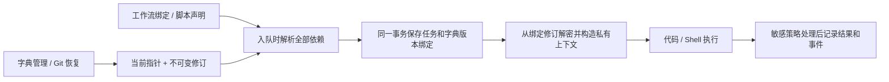

# 字典、加密字典与 Git 同步方案

状态：实施中。任务 0–3 及任务 4 的管理服务、HTTP API、字典页面、密钥设置页与 CLI 已实现；引用扫描、运行绑定、敏感执行与 Git v2 尚未完成，功能未完成整体验收。实施与验证记录见 [implementation-notes.md](./implementation-notes.md)。
创建日期：2026-11-09。
最后更新：2026-11-09。

## 1. 目标与设计基线

提供工作流与脚本共用的配置字典，将接口地址、业务参数、映射表及访问凭据从源码中抽离。字典按稳定 ID 引用，更新后供新运行使用；运行入队时固定修订，已排队和执行中的任务继续使用原值。普通字典和加密字典均接入现有 Git 配置存储。

本文以当前本地单用户、单 data-dir 工作台为范围，以下首期产品规则作为本次实现基线，不再留待编码时选择。沿用现有不可变发布版本与配置写入协调机制，并按第 5 节和第 11 节扩展入队协调、回执及安全写入接口；“复用”不表示现有接口已经具备全部能力。数据库实施许可单独按第 9.4 节记录。

| 项目 | 首期方案 |
| --- | --- |
| 普通字典 | 具名的键值集合，支持字符串、数字、布尔值及 JSON |
| 加密字典 | 具名的敏感字符串集合，值加密保存；名称、键名与说明可见 |
| 生效方式 | 保存立即产生不可变修订，新运行读取最新启用修订，无独立发布操作 |
| 工作流引用 | 普通字典增加结构化输入绑定；内嵌代码和 Shell 可声明字典依赖 |
| 脚本库引用 | 脚本定义声明依赖，通过运行上下文读取，独立测试和工作流调用行为一致 |
| 加密值使用 | 只向显式声明依赖的代码或 Shell 提供；首期不允许进入 Agent、Web Bridge 或公开运行结果 |
| Git 同步 | 复用“设置 → Git 配置”的手动预览、提交、推送、获取和恢复；普通保存不触发网络 |
| 密钥设置 | “设置 → 加密字典密钥”支持生成、导入、备份、验证和切换活动密钥，常规查询不返回密钥材料 |
| 身份与可移植性 | 对象 ID、修订版本 ID 跨设备稳定，本机修订序号不作为跨设备身份 |
| 删除 | 首期只提供启用、禁用和键移除，保留历史修订与运行绑定，不提供物理删除 |

首期不包含多用户权限、项目或环境继承、同名字典覆盖、远程工作台页面与反向代理接入、远程 Secret Manager、定时拉取、Git 双向自动合并、字符串插值表达式、用易记口令派生字典密钥，以及在工作流中手动固定字典历史版本。需要区分开发和生产时，创建不同字典并显式引用。

首期明确接受两项产品限制：声明加密依赖的节点及其可达后继隐藏业务输出和日志；敏感范围内不能调用 Agent 或 Web Bridge。界面在声明依赖时说明这些限制，发布前展示受影响节点。跨设备使用指两端分别访问自己的本地工作台，通过 Git 和独立密钥备份交换配置，不要求远程访问某一台工作台。

相关现状与设计依据：

- [流程格式和脚本协议](../../wiki/architecture/workflow-format.md)：现有 `Binding` 支持 literal、workflow、node、object、array，使用 JSON Pointer，不执行表达式。
- [脚本库](../../wiki/product/script-library.md)：发布版本不可变，工作流固定脚本版本，测试使用提交时的源码快照。
- [配置 Git 存储](../2026-11-06-config-git-storage/design.md)与[操作说明](../../wiki/operations/config-git.md)：已有托管仓库、固定 SHA 恢复、依赖校验、恢复点和跨存储恢复协议。
- [Agent 模型配置](../2026-11-07-agent-model-configs/design.md)：已有“定义引用稳定 ID、运行固定配置修订”的模式。
- 当前 `src/persistence/schema.ts` 数据库版本为 8。现有运行输入输出、事件和测试日志会进入 SQLite 或产物文件，需同步调整敏感数据路径。

## 2. 场景与用户流程

### 2.1 维护共享配置

用户在“字典”页面创建“订单服务”，选择普通字典，添加 `baseUrl`、`timeoutMs` 和 `statusLabels`。多个工作流通过 ID 与键引用这些值。修改地址并保存后，无需重新发布工作流；后续运行使用新修订，历史运行仍显示原字典修订。

用户在保存前看到受影响的工作流、脚本及当前发布版本数量，确认本次修改会影响后续运行。名称调整不改变引用身份；移除被使用的键需二次确认，并明确列出将失效的依赖。确认后允许保存，由新运行的完整依赖检查阻止失效任务入队。

### 2.2 使用访问凭据

首次使用时，用户进入“设置 → 加密字典密钥”，生成随机密钥并下载密钥备份；已有其他设备的密钥时直接导入。设置页验证密钥就绪并选定活动密钥后，用户创建加密字典“订单凭据”，写入 `apiToken`。脚本声明只需要此键，在运行上下文中读取并发起请求。字典列表、详情、差异、历史和 Agent 创作上下文仅展示键名、类型、是否已设置及可用状态。

加密值采用写入后不可回读的管理方式：编辑时可“保持原值”“替换”“移除”，不会将 `******` 当作实际值保存。首期不提供复制或显示现有明文按钮。保存成功后清空表单中的敏感输入，不写入浏览器持久化存储。

### 2.3 Git 往返

设备 A 在“设置 → 加密字典密钥”生成并备份密钥，再在现有 Git 配置页预览并提交字典、相关工作流和脚本。设备 B 通过独立安全渠道取得备份，在自己的密钥设置页导入，然后从 Git 预览恢复。普通字典可直接使用；加密字典必须完成密钥匹配和认证解密后才可参与新运行。整个流程可通过页面完成，不要求使用 CLI；Git 仓库不保存密钥备份。

仓库恢复只更改定义和当前修订指针，不执行脚本、工作流或模型请求。恢复旧值会影响后续新运行，界面需明确提示可能恢复了已经撤销的旧凭据。

## 3. 字典模型与行为规则

### 3.1 对象与键

字典包含 `id`、`name`、`description`、`kind`、`enabled`、本机 `revision`、`currentVersionId` 和时间字段。`kind` 为 `plain` 或 `encrypted`，创建后不可切换，避免普通值被误认作密文或凭据意外转为明文。需要切换时创建新字典并显式调整引用。

- `id` 为系统生成的稳定 UUID，名称去除首尾空白、长度 1–100，按 SQLite `NOCASE` 全局唯一。跨设备同名不同 ID 属于命名冲突，不自动合并。
- 说明最长 2000 字符。名称、说明和键名不承诺保密，编辑器提示不要填写敏感内容。
- 键名区分大小写，匹配 `^[A-Za-z][A-Za-z0-9_-]{0,99}$`；`__proto__` 等不满足规则。键名中的点不表示层级；JSON 子路径通过 pointer 选择。
- 普通条目为 `{ type, value }`，`type` 为 `string | number | boolean | json`，按类型严格校验，不做字符串隐式转换。数字必须有限；JSON 值允许 null，拒绝重复对象键和非 JSON 值。
- 加密条目仅支持 `string`，空字符串与未设置区分；没有默认值和自动回退。敏感的结构化内容可保存为 JSON 字符串，由脚本自行解析。
- 单条值最多 64 KiB UTF-8，每个字典最多 500 键，每个修订的值合计最多 1 MiB；JSON 最大嵌套深度 32。字符串按原字符串 UTF-8 字节数计量，其他普通值按规范化 JSON 的 UTF-8 字节数计量；加密字符串在加密前计量，已有密文可按 GCM ciphertext 的解码字节数检查限额，不另存或展示明文长度。加密封装与文件大小另计，超限在写入前拒绝。

字典可移植定义、AAD 和新协议请求的规范化统一采用 UTF-8 字节序排序对象键、保持数组顺序、无空白的 JSON；数字采用 JSON 有限数字表示，负零规范化为 0。长度规则按 Unicode 码点计数，名称唯一性严格沿用 SQLite NOCASE，不额外进行 Unicode 大小写折叠。管理请求、密钥备份及 Git 字典 JSON 在转换为普通对象前使用能拒绝重复对象键的解析器；普通 `JSON.parse` 不能满足这一要求。不得全局替换旧脚本或 Git v1 的规范化算法。

同一字典内不能重复键。键重命名按“移除旧键、添加新键”处理，不重写已发布工作流或脚本版本。首期不允许运行中的脚本修改字典。

### 3.2 修订与并发

每次有效保存创建新 `versionId`，并递增本机 `revision`；名称、说明、启用状态和完整条目均进入该不可变修订。完全相同的保存返回无变化，不产生修订。更新请求必须携带 `expectedRevision`，并发冲突返回 409。

`versionId` 为跨设备稳定 UUID。相同版本 ID 必须具有相同规范化内容与摘要；同 ID 内容不同是硬冲突。对象的本机 `revision` 是修改计数，用于乐观锁；版本另有本机 `versionNo` 用于展示顺序，导入新版本时分配，不能用于跨设备匹配。恢复已有旧版本只移动当前指针并递增对象 revision，不修改旧版本的 versionNo，也不要求二者相等。

禁用阻止新发布、新测试和新运行引用，不改写已创建运行的绑定。已入队任务继续使用已绑定且当时启用的修订。需要立即停止凭据使用时，应取消活动任务并在外部服务撤销凭据；禁用字典本身不等同于凭据吊销。

## 4. 工作流与脚本引用协议

### 4.1 工作流输入绑定

扩展现有 `Binding`，增加以下形状，只允许普通字典：

```json
{
  "source": "dictionary",
  "dictionaryId": "11111111-1111-4111-8111-111111111111",
  "key": "statusLabels",
  "pointer": "/paid"
}
```

`pointer` 可省略或为空，沿用现有 JSON Pointer。键不存在、pointer 不存在、字典禁用或类型不符均明确失败，不默认为 null，也不回退到同名对象。该绑定可嵌套于 object/array，适用于节点输入和最终 `result`；JSON 值按副本返回，脚本修改不能影响共享快照。

普通值可供 code.nodejs、shell、script、switch、agent 和 web-bridge 节点使用。提示词需要配置时通过节点输入传入，不增加 `${dict.xxx}` 一类文本替换语法。

绑定自身声明了普通字典依赖，不需要重复添加到脚本上下文声明。依赖扫描必须同时覆盖节点输入、最终结果和所引用的固定脚本版本。加密字典用于此绑定时返回 `SECRET_BINDING_FORBIDDEN`，不能以普通输入预览或输入 Schema 诊断暴露值。

### 4.2 脚本依赖声明

脚本库在 `ScriptDefinition` 增加可选 `dictionaryBindings`，并随草稿、测试快照和不可变发布版本保存：

```json
{
  "dictionaryBindings": {
    "service": {
      "dictionaryId": "11111111-1111-4111-8111-111111111111",
      "kind": "plain",
      "keys": ["baseUrl", "timeoutMs"]
    },
    "credentials": {
      "dictionaryId": "22222222-2222-4222-8222-222222222222",
      "kind": "encrypted",
      "keys": ["apiToken"]
    }
  }
}
```

工作流内嵌 code.nodejs、shell 节点在 `config.dictionaryBindings` 使用同一结构。`script` 节点从其固定脚本版本读取声明，不允许在节点上覆盖依赖，以保证独立测试和工作流调用一致。

别名只在该脚本上下文中有效，匹配键名规则；一个脚本最多 32 个别名、合计 256 个键，每个声明必须明确列出非空且不重复的键，不支持 `*`。`kind` 必须与目标字典一致，避免只换 ID 就改变敏感属性。未声明的字典和键均不可通过上下文读取，禁止运行时按名称查找或调用通用字典管理 API。

旧脚本没有此字段时运行语义等同于空声明，但序列化继续省略该字段；显式空对象在新写入时也归一化为省略。旧产物和 Git v1 继续使用原字节及原摘要算法，不回写补字段。新脚本声明的别名按 UTF-8 字节序排列，keys 排序去重前先拒绝重复输入；声明随脚本定义进入源码产物和摘要。读取不可变版本必须从其定义产物取得声明，不能使用当前草稿或脚本对象补齐。Git v2 对无字典声明的旧脚本继续按旧版可移植脚本摘要计算，避免同版本 ID 产生虚假冲突。

### 4.3 Node.js 使用方式

为默认导出函数增加可选第二参数，现有单参数函数保持可用：

```ts
export default async function run(input, ctx) {
  const baseUrl = ctx.dictionaries.get("service", "baseUrl");
  const token = ctx.secrets.get("credentials", "apiToken");
  const response = await fetch(`${baseUrl}/orders/${encodeURIComponent(input.id)}`, {
    headers: { Authorization: `Bearer ${token}` }
  });
  if (!response.ok) throw new Error("订单请求失败");
  return { status: response.status };
}
```

`ctx.dictionaries.get` 仅接受普通依赖，返回 JSON 副本；`ctx.secrets.get` 仅接受加密依赖并返回字符串。不存在或越界访问抛出固定错误码，错误文本不拼接值。上下文只在执行进程内构造，不允许源码通过 import 直接连接服务端 Store。

上述脚本使用了加密字典，其输出按第 7 节视为敏感结果；首期只展示执行状态，不公开返回的业务 JSON。需要展示脱敏后的业务数据属于后续显式解密级别设计，不凭脚本字段名推断安全。

### 4.4 Shell 使用方式

保留 stdin 为原业务 JSON，`ORCHARD_RESULT_FILE` 输出协议保持兼容。宿主注入 `ORCHARD_DICTIONARY_FILE`，指向本次尝试私有的 JSON 上下文文件，包含且仅包含声明的别名和键。其结构为 `{ dictionaries: { alias: { key: value } }, secrets: { alias: { key: value } } }`。

提供宿主生成的 `ORCHARD_DICTIONARY_HELPER` 路径，使用当前 Node 可执行文件运行；不依赖目标机器安装 jq。示例：

```bash
base_url="$("$ORCHARD_NODE_EXECUTABLE" "$ORCHARD_DICTIONARY_HELPER" plain service baseUrl)"
# helper 输出单个 JSON 值；--raw 只适用于字符串，保留字符串末尾换行需自行用文件或管道读取。
token="$("$ORCHARD_NODE_EXECUTABLE" "$ORCHARD_DICTIONARY_HELPER" secret credentials apiToken --raw)"
```

上下文值不放入宿主启动命令行或环境变量，环境变量只包含路径。Node wrapper 也从私有文件构造第二参数，所有执行入口使用同一注入模块。Shell 脚本主动将 token 传给外部程序时仍需避免命令行泄漏；内置示例采用配置文件或 stdin 传递凭据。

## 5. 校验、入队快照与生命周期



1. 保存草稿允许暂时缺失依赖，返回诊断；发布严格检查对象存在、启用、kind、键和可静态判定的类型，并计算敏感节点范围。发布只保留 ID、键和声明，不嵌入字典值或固定字典修订。
2. 新建工作流运行、草稿测试、脚本草稿或发布版本测试时，收集完整依赖闭包；包括固定脚本版本声明、最终结果引用，以及当前分支暂时不会执行的节点。
3. 同一数据库事务读取每个字典当前修订，检查全部键、普通值 Schema 以及加密值认证解密可用性，再创建任务与绑定。一项失败则不产生任务、部分绑定或成功回执。同一字典在同一任务中只能绑定一个修订。
4. 绑定保存所需键集合。每个脚本的实际可见集合仍按其不可变声明收窄，不能把任务内所有节点的凭据都交给某一个节点。
5. 所有新增或改造的运行/测试入队路径在 SQLite 事务内不进行网络、编译或文件写入。输入和源码产物按第 5.2 节预先准备；最终密钥快照复查、同步认证、任务与绑定写入由第 5.1 节的同步入队保护覆盖。失败诊断仅定位对象及键。
6. 执行只读取已绑定修订，不能重新查询最新值。字典更新、键移除、禁用或 Git 恢复不改变已绑定值；密钥后来不可用时明确失败，不回退到新修订。
7. 幂等请求先检查原回执，匹配则返回原任务，不因最新字典状态变化重新入队。主动“再次运行”使用新 requestId 与当前修订。
8. 排队任务重启后仍使用原绑定。沿用现有运行/测试中断规则，不自动重放执行中的脚本。历史修订首期全部保留，禁止清理仍被运行、测试、当前指针或恢复操作引用的版本。

普通字典的静态检查可根据当前条目类型推断输入 Schema，但当前值可能随后改变，运行时仍执行全部 Schema 校验。`json` 子路径不能证明类型时给出无法静态判定的诊断，不宣称必定兼容。入队时检查全部普通字典键与 pointer；对于同时混合上游节点结果的输入，仅校验当时可解析的部分，其余在节点执行前校验，不能为入队校验而提前运行节点。

### 5.1 入队保护与锁顺序

现有 `withRead` 面向无活动时的配置快照读取，存在 activity 时会拒绝，不能用于运行入队。新增同步 `ConfigWriteCoordinator.withAdmission(action)`，复用同一协调器的写入占用状态，但不修改既有 `withRead` 的语义：

| 操作 | 与现有 queued/running activity 共存 | 互斥关系与代次 |
| --- | --- | --- |
| `withAdmission` | 允许 | 与配置 reader、writer、另一入队保护和恢复 exclusive 互斥；入队本身不递增配置 generation |
| `withWrite` | 继续允许 | 字典、脚本定义、密钥环写入不能与入队保护重叠；真实配置写入沿用配置代次规则 |
| `withRead` | 继续拒绝 | 保留现有 Git 快照读取约束；不得嵌套进入队 activity |
| `withExclusive` | 拒绝 | Git 恢复和需要空闲的清理必须等待全部活动释放 |

`withAdmission` 仅接受同步回调，禁止 await；检测到 Promise 返回即视为编程错误，不能把异步工作放入其中。它允许同一所有者在回调内登记任务 activity，不允许嵌套定义写入、`withRead` 或恢复。锁忙时返回 CONFIG_BUSY，由客户端保留 requestId 重试；不等待活动任务结束，也不建立异步锁等待链。

统一顺序如下，发布运行、工作流草稿测试、脚本草稿测试和脚本发布版本测试使用同一入队服务：

1. 进入短期 `withActivity("…:accept")`，阻止恢复穿过准备阶段。先在同步入队保护内查找并校验已有回执；命中则按步骤 4 补登记活动并返回原任务，不加载字典密钥、不编译、不检查当前依赖。
2. 未命中时，在 SQLite 事务外读取不可变定义、编译、准备输入/源码引用并加载完整密钥环快照。草稿准备阶段记录 revision 和源码摘要；期间允许配置修改。
3. 进入 `withAdmission`，调用同步命令事务，首先再次查找并核对回执；命中则跳过一切当前状态检查。未命中才复查草稿 revision、源码身份和密钥文件指纹，必要时同步读取并加载一份完整且有效的最新密钥快照。确定该次使用的 generation，不允许逐键读取不同代次，再读取当前字典、校验、认证解密并写任务及绑定。事务提交前再次检查密钥文件指纹，变化则回滚并返回代次冲突。加密服务只使用本次固定内存快照；无加密依赖时不要求密钥环可用。
4. 提交后、释放入队保护前，登记持久任务对应的长期 activity，再释放 accept activity。回执重放只对仍 queued/running/cancel_requested 的任务补登记，登记按任务 ID 幂等。提交失败释放 accept activity，不创建长期 activity；失败回调不得启动队列。
5. 保护释放后唤醒队列。任务只固定字典 versionId，不持久化密钥材料；每次执行尝试从完整密钥快照解密绑定修订，不跨 await 复用可变密钥环对象。

已有执行活动不会阻止新入队；字典保存和活动密钥切换可以发生在两个入队之间，不影响旧绑定。密钥文件被外部替换时，缓存按完整文件指纹原子重载；替换恰好发生在事务最终检查之后的任务仍属于之前完整快照，后续执行若缺少其 keyId 则明确失败。该检查不承诺阻止同一系统用户恶意改写文件。

### 5.2 文件准备与事务边界

现有 `Store.reference` 在数据超过 32 KiB 时调用 `writeBlob`，因此不能直接用于本次改造后的入队事务。拆分为两个接口，保持现有引用编码与 16 MiB 数据上限：

- `prepareReference(safeValue)`：在事务外序列化；小值生成 inline 描述，大值在受控 staging 写入、fsync 后安装到不可变内容寻址路径并 fsync 父目录，返回不含可变外部路径的描述。复用已有文件时校验字节数与摘要。输入必须先经过敏感策略，不接受字典明文上下文或未处理的敏感输出。
- `attachPreparedReference(prepared)`：只在事务内校验描述并登记 artifacts 行、返回引用编码；不创建目录、写文件或编译。事务前已安装的文件在准备 activity 存续期间不得被清理。

改造范围明确包含 `GraphRunner.create`、`GraphRunner.createDraft`、`Store.createScriptTest` 及其 HTTP/CLI 调用入口：用户输入、脚本定义快照、工作流源码快照和可能超出 inline 限额的安全回执结果都在事务外准备。脚本测试仍在同一个 input_ref 中保存业务输入及 scriptSnapshot 引用，保持历史读取兼容；固定敏感标记不应覆盖执行需要的内部源码引用。脚本测试最初由用户提交的业务输入按原输入策略存储，对敏感测试的公开 DTO 隐藏该输入；不能将字典明文合并到这个输入或快照中。

入队事件和回执使用有界安全 DTO，只包含任务 ID、状态和定义身份等元数据；不把大输入、字典值或解密结果复制进回执。敏感节点后续执行的输入、输出、route、错误和日志仍在调用 `reference`、`append` 或写执行信息之前执行第 7 节策略。此处不要求重构所有无关历史 Store 调用。

准备后事务失败时允许留下未登记或尚无业务引用的普通产物，不留下任务、绑定或成功回执。活动结束后才可清理；清理在配置排他窗口、无活动时扫描全部有效根（含源码快照、命令回执、Git prepared 日志与恢复点），保留至少 24 小时，无法证明未引用则保留。不得在失败 finally 中直接删除共享内容寻址文件；敏感临时文件按第 7.3 节立即清理，不进入这套延迟清理。

## 6. 加密与密钥管理

### 6.1 存储格式

使用 Node `crypto` 的 AES-256-GCM；每次新写入或替换一个值生成随机 12 字节 nonce，保存 16 字节认证 tag。使用 32 字节随机密钥，禁止把用户短口令直接作为 AES 密钥。

每条加密值保存以下封装；仅示意字段，示例中的占位符不是合法密文：

```json
{
  "type": "string",
  "encryptedValue": {
    "formatVersion": 1,
    "algorithm": "aes-256-gcm",
    "keyId": "orchard-key-uuid",
    "nonce": "<base64>",
    "ciphertext": "<base64>",
    "tag": "<base64>"
  }
}
```

AAD 为规范化 JSON，固定包含 `formatVersion`、`algorithm`、`keyId`、`dictionaryId`、`key` 和 `type`，避免将密文移到另一个字典或键后仍可解密。AAD 不包含本机序号或修订版本 ID，因此未变更的条目可在新修订中复用原密文。字段名、Base64 长度与未知算法严格校验，认证失败直接拒绝。

相同内容连续导出必须字节一致；导出不重新加密。普通元数据修改或其他键修改时复用未变更条目的密文；用户显式“替换”加密值即视为一次变更，哪怕输入恰好相同也可生成新密文。不得为加密值生成或导出明文 SHA-256、长度、前后缀或可离线枚举的明文校验码。密文长度仍可能暴露大致内容长度，首期不增加填充协议。

### 6.2 密钥环与存储边界

默认密钥环位于 `<data-dir>/secrets/keyring.json`，目录 0700、文件 0600，拒绝符号链接和宽松权限。部署可通过 `ORCHARD_SECRET_KEYRING_FILE` 指定 Git 目录之外的绝对路径。密钥环包含独立 `keyId`、密钥材料与活动写入密钥 ID；普通字典值、密文中的 keyId 和实际密钥材料分别管理。

密钥材料不进入业务数据库、Git 导出、本机引用映射、普通设置 DTO 或操作回执。首期允许通过专用导入请求接收密钥，通过用户主动发起的专用备份下载返回密钥文件；常规查询、生成成功响应及切换密钥响应均只返回安全元数据。密钥仅保存在服务端密钥环，不能把浏览器缓存作为唯一持久化来源。

首期使用系统生成的 32 字节随机密钥。导入接受本功能生成的版本化备份文件或其完整文本，不将任意短字符串、Git 访问密码或仓库 Token 当作字典密钥。用户易记口令及 Argon2id/scrypt 派生方案不纳入首期。

### 6.3 设置页操作与跨设备恢复

新增“设置 → 加密字典密钥”，以“当前活动密钥”和“其他已保留密钥”展示密钥环，正常进入页面不回填密钥材料。页面包含以下能力：

| 操作 | 行为规则 |
| --- | --- |
| 查询状态 | 展示未配置、已就绪、缺少密钥、认证失败或存储只读；显示 keyId、活动标志、密钥环代次及受影响字典数量 |
| 生成密钥 | 在服务端生成随机密钥与唯一 keyId；空密钥环中首次生成的密钥自动设为活动，已有密钥时明确选择是否设为活动，不覆盖历史密钥 |
| 导入密钥 | 文件上传或粘贴完整备份文本，严格校验格式及材料长度；导入采用合并，已有活动密钥默认保留；空密钥环导入时明确选择一个活动密钥，备份中的 activeKeyId 仅作为建议 |
| 备份密钥 | 用户主动点击并确认包含范围后下载专用备份文件，默认包含全部字典密钥以支持历史恢复；提示文件包含解密材料，应与 Git 仓库分开保管 |
| 验证密钥 | 对指定范围当前加密字典逐条认证解密，只返回成功数量、缺失 keyId 和失败位置，不返回明文；无可验证密文时显示“密钥格式有效，尚未验证解密” |
| 切换活动密钥 | 只能选择已存在且格式有效的密钥，确认后仅影响后续新增或替换的加密值，不自动重新加密现有值 |

生成、导入和切换活动密钥要求 `expectedGeneration` 与 requestId；并发变更返回冲突。同 requestId 重试先核对原请求摘要并返回原操作元数据，不先因当前代次已改变而拒绝，也不重复生成密钥。密钥环连同安全操作标识在同一受权限保护的文件中原子持久化，先写临时文件并 fsync，再 rename 和 fsync 父目录；重启可根据该记录确认已完成操作，不能把密钥存入数据库回执。导入请求摘要沿用第 7 节的本机 HMAC，日志与回执不保存原始备份文本。

备份文件采用独立格式，包含 `formatVersion: 1`、可选 `activeKeyId` 以及 `keys: [{ keyId, algorithm, material }]`，algorithm 固定为 aes-256-gcm，material 为 32 字节密钥的规范 Base64。导入拒绝未知字段、重复 keyId、非法编码和格式版本，文件最多 1 MiB、合并后最多 256 把密钥；一项冲突则全部不应用。相同 keyId 且相同材料为无变化，相同 keyId 不同材料拒绝，不能覆盖以“修复”解密错误。备份不包含字典值、Provider 凭据、运行上下文或本机命令回执 HMAC 密钥，后者仅随本机数据库恢复资料单独备份。

浏览器仅在用户显式导入时持有输入文本，提交完成或取消后清空；禁止存入 localStorage、IndexedDB、URL、分析埋点或持久化草稿。备份通过同源 POST 下载，响应采用 `Cache-Control: no-store` 与 attachment，不使用带密钥或下载授权的长期 URL，不经 Service Worker 缓存，客户端生成的临时 Blob URL 在下载后释放。服务端不保存可公开下载的备份副本，不将下载正文写入回执。生成响应只提示“请备份”，不显示或自动复制密钥。

首期仅支持通过本机回环地址访问工作台，保留当前本地 Host 限制，不开放远程 Host、HTTPS 代理或转发头信任。密钥读接口沿用本地访问边界；密钥生成、导入、导出、验证和活动密钥切换，以及加密字典写入与换钥，还必须校验 Origin 与当前本地 HTTP authority（含端口）完全一致，拒绝跨端口来源、浏览器扩展来源和不匹配的 Sec-Fetch-Site。无 Origin 的 API 请求必须提供有效 `x-orchard-token`；CLI 通过持有 data-dir lease 的同一服务调用或已认证本地 API 操作，不能绕过正在运行的服务直接写密钥文件。不信任 X-Forwarded-Host / X-Forwarded-Proto 来放宽本地限制。

远程明文 HTTP、远程 HTTPS 和反向代理页面访问均不属于首期支持范围；未来增加时需单独设计 Host/Origin 白名单、代理信任与传输保护。请求体、响应正文及异常堆栈不得记录密钥；设置页不提供常规“显示已有密钥”按钮。文件备份本身包含明文密钥材料，页面需明确告知其敏感性。密钥请求的解析和异常处理使用固定安全错误，不直接返回解析器原始 message 或请求片段。

另一设备通过独立安全渠道获得备份文件，在设置页导入并验证后可解密 Git 中对应的字典。仅持有 Git 仓库不能恢复密钥，密钥丢失后不能解密已有值，需要重新录入并在服务侧替换凭据。导入后重新计算 locked 字典的可用性；某些字典仍缺其他 keyId 或认证失败时保留诊断，不因导入一把密钥就将全部字典标为就绪。

CLI 提供同等能力，新增 `orchard secrets keyring init`、`import --file`、`export --file`、`status`、`verify`、`activate --key-id`，调用同一密钥服务及代次校验。密钥值不作为命令行参数，不打印到 stdout。外置密钥环文件只读时仍可查询、验证和备份，生成、导入和切换活动密钥返回明确错误，不回退创建另一份本机密钥环。

### 6.4 换钥、历史与保护范围

新值使用活动 keyId，历史密钥保留。对一个字典执行“重新加密”时需先预览，全部值认证成功后产生新修订；老修订仍使用老密钥。预览返回服务端保存的短期 token，绑定 dictionaryId、expectedRevision、currentVersionId、内容摘要、目标 activeKeyId、配置 generation、密钥 generation 与文件指纹，有效期 10 分钟，不包含明文。执行按原 requestId 回执优先；未命中才校验 token 与上述基线，变化返回 PREVIEW_EXPIRED。只重新加密 keyId 与目标不同的条目，已经使用目标密钥的条目复用封装；全部已匹配时返回无变化。任何值认证失败或写入失败均不移动当前指针。不能因当前指针已经换钥而删除仍被历史、队列或恢复点使用的密钥。首期不提供密钥删除、批量销毁历史密钥或 Git 历史重写。

密钥设置不会更改 Git 认证凭据，也不会把密钥环加入 Git 同步；加密历史长期保留于 Git，活动密钥切换不能使旧密文自动失效。实际凭据泄漏时仍需在外部服务撤销或轮换。

本方案保护 Git 内容、数据库单独副本和常规 API 展示。默认密钥环与数据库同机时，获得完整主机或整个 data-dir 的人可能同时获得密钥；脚本也具有当前系统用户权限。字典依赖声明是产品访问边界，不是操作系统沙箱。外部密钥文件有助于备份隔离，不能替代主机权限管理。

## 7. 敏感执行与防止日志泄漏

### 7.1 敏感范围

任何声明了加密字典的脚本节点均标记为敏感，不依赖它是否实际调用了 `ctx.secrets.get`。从该节点沿工作流连线可达的后续节点一并标记为敏感，以覆盖数据传递与分支控制影响。首期采用此保守规则，不根据输出 Schema、字段名称或开发者自称“已脱敏”解除标记。

敏感范围内出现 Agent 或 Web Bridge 时，发布和入队均拒绝并定位路径。用户应将模型分析等步骤安排在使用凭据的脚本之前；由脚本自行完成需要凭据的网络请求。普通字典可正常传入 Agent。首期不提供解除敏感标记或向外公开敏感结果的开关。

### 7.2 持久化与展示

敏感节点在内存中保留真实输入输出供后续本地代码、Shell 或 switch 使用，校验仍针对真实值执行。写入 SQLite、产物、SSE 和 API 之前统一替换以下内容：

| 数据 | 首期行为 |
| --- | --- |
| 节点输入、输出与 switch route 的 value | 不保存明文，以专用 `redacted` 标志呈现，不以此占位值参与后续计算 |
| stdout、stderr、流式日志 | 不持久化或推送原文，页面显示“此节点使用加密字典，日志未保存” |
| 原始异常、Schema 校验值、进程错误片段 | 只保留白名单错误码与固定安全消息，不回显异常 message 或 stderr |
| 执行信息 | 保留节点 ID、字典版本 ID、状态、耗时、退出码等必要元数据 |
| 最终结果依赖敏感节点 | 保存并返回 `outputRedacted: true`，不提供明文下载；仍在内存中校验最终输出 Schema |
| 脚本测试使用加密字典 | 同样隐藏输入输出和日志，保留状态与安全诊断；不能将原结果附加给 Agent |

敏感状态由定义与运行绑定重新计算，DTO 显式增加 `inputRedacted`、`outputRedacted`、`logsRedacted` 等标志，不能让现有消费者把占位对象误认成业务结果。原始日志不能先进入 `Store.append` 再由前端隐藏，也不能仅通过字符串替换实现保护；短 token、分段输出或编码后的值均可能绕过替换。

统一的敏感策略服务在解析节点输入前确定该节点范围，包围输入解析/校验、执行、输出校验、错误处理和事件构造；不能仅在执行器成功返回后脱敏。最终 result 的 object/array 递归扫描若引用任一敏感节点，则整个最终结果敏感；最终结果解析与 Schema 失败也按此范围处理，即使当前 activeNode 已清空。读取 DTO 和补发 SSE 不能根据当前字典启用状态解除历史敏感标记。执行定义或绑定损坏、无法可靠重建范围时按整个任务敏感处理并失败，不降级为公开原始数据。

敏感错误只保留宿主确定的 CANCELLED、TIMEOUT、OUTPUT_LIMIT、PROCESS_START_FAILED、PROCESS_FAILED、INVALID_SCRIPT_OUTPUT、SCHEMA_MISMATCH 及本设计的字典/密钥错误码，message 从服务端固定映射产生；用户抛出的 code 不受信任，其他异常归一化为 EXECUTION_FAILED。安全位置可单独返回 nodeId、dictionaryId、key，不携带堆栈、原始 Schema 错误、stdout/stderr 或值。原始 Error 不传递给通用 HTTP 错误处理器。

状态、耗时、退出码、已执行节点和所选分支等操作元数据仍可见，不承诺隐藏控制流侧信道。脚本主动发起的网络、文件或子进程行为属于其执行权限范围，本功能不声称阻止恶意脚本外传凭据。

### 7.3 临时明文与进程环境

字典上下文与现有脚本 JSON 结果文件属于执行期间必要的临时明文，必须处于每次尝试独立的 0700 目录，文件 0600。敏感结果读取和 Schema 校验后尽快删除，成功、失败、超时、取消均在 finally 清理，禁止放入版本产物、可下载静态目录或恢复点。

服务重启时，在队列启动前清理经过校验的遗留敏感临时目录；清理只操作专用上下文目录，不递归删除不可变源码或其他运行资料。关闭 core dump，并避免诊断工具记录进程内存；首期不承诺文件删除能抵抗磁盘取证。

当前内嵌工作流脚本存在继承宿主环境的路径，脚本库执行已有环境白名单。此次需统一为白名单，避免密钥环位置、Provider 凭据或宿主 secret 环境变量被隐式带入。字典敏感值与密钥材料不得进入 HTTP 请求/响应日志、命令回执结果、Agent 上下文、源码提示或 Git 差异诊断；专用密钥备份响应只向主动发起下载的客户端传输，不经过普通 DTO 或事件流。

### 7.4 敏感命令回执与本机 HMAC 密钥

加密字典写请求不能直接复用 `Store.command` 对明文请求生成普通 SHA-256。新增受限的敏感命令入口，计算 `HMAC-SHA-256(localKey, canonical({ protocol: "orchard-sensitive-command-v1", scope, request }))`，然后复用 Store 的同步事务与 `(scope, request_id)` 唯一性；不得把明文先交给旧 `command` 再覆盖摘要。scope 使用独立 `dictionary-secret:*` / `secrets:*` 命名空间，调用者不能通过 HTTP 指定任意摘要或 scope。普通字典及旧命令继续使用原 SHA-256 协议。回执仅保存 HMAC 和安全 DTO，同 requestId 不同内容返回 REQUEST_CONFLICT。

本机 HMAC 密钥为独立随机 32 字节文件 `<data-dir>/secrets/command-hmac.key`，权限与符号链接规则同密钥环。首次敏感写入前，在协调器 `withWrite` 内原子创建并 fsync，先于任何敏感数据库回执或密钥环操作记录；密钥生成、导入和切换的文件内操作记录也使用它。只有不存在敏感 scope 回执且密钥环没有本机操作记录时才允许首次创建。已有敏感记录而文件丢失或损坏时返回 SECRET_RECEIPT_KEY_MISSING，阻止敏感写入与重试，不生成替代密钥；普通字典、已有可解密任务和只读查询可继续工作。

密钥环文件内记录 `{ scope, requestId, requestHmac, result }`，result 仅含 keyId、generation 等安全元数据，并与 keys 一次原子替换；重试先核对记录，再检查 expectedGeneration。只读外置密钥环拒绝需要新增操作记录的写请求，无变化请求不递增 generation，但仍需持久化首次成功回执以保证后续重试。文件操作回执与数据库回执不互相替代，不要求跨二者提交一笔分布式事务。

本机数据库恢复资料必须同时保留此 HMAC 文件；常规 Git 快照、专用字典密钥备份和对外下载的迁移报告均不包含它。恢复数据库前校验相应 HMAC 文件，缺失时报告敏感命令不可用，不能假装历史 requestId 是新请求。HMAC 文件丢失但原字典密钥环可用时仍可执行旧任务，不代表能够校验旧写请求。

## 8. Git 格式、同步与兼容

### 8.1 复用现有操作

新增 `dictionaries` 配置类别，普通与加密字典在此类别内分组。接入现有提交预览、仅本地提交、提交并推送、fetch、历史、固定 SHA 恢复、本地恢复点和故障恢复；不建立第二套仓库绑定、认证或后台同步任务。

普通值按稳定顺序输出 JSON；加密值输出原密文封装。使用既有 ID 到目录名的可逆 UTF-8 十六进制编码与路径限制。示意目录：

```text
<配置目录>/
  manifest.json
  dictionaries/
    <encoded-dictionary-id>/
      dictionary.json
      versions/
        <encoded-version-id>.json
  workflows/...
  scripts/...
```

`dictionary.json` 保存 `id`、不可变 `kind` 与 `currentVersionId`；当前名称、说明、启用状态和完整条目由对应版本给出。版本文件保存稳定 `id`、`dictionaryId`、`name`、`description`、`enabled`、`kind` 与 `entries`，不导出本机 revision、versionNo、时间、运行绑定或密钥。

导出全部当前字典及其当前修订，不默认导出全部本机历史；旧值可由 Git 历史提交获取。恢复点另外完整保存受影响的修订及必要密文，不保存密钥和运行临时上下文。无关历史修订仍在本机保留。

manifest 增加字典对象及版本摘要，并扩展工作流、脚本依赖索引。字典依赖记录 `category: dictionaries`、字典 ID、kind 与键集合；它表示“当前运行配置需求”，不伪造固定字典版本依赖。已有脚本版本依赖继续使用固定 versionId 与 digest。所有文件继续受完整文件集合、字节数和摘要校验保护。

### 8.2 格式升级

当前 Git 格式 v1 严格固定五个类别，不能在其中直接增加文件。引入配置快照 `formatVersion: 2` 与对应最低程序版本，默认新导出使用 v2。工作流定义首期保持 `formatVersion: 1`，在严格 Binding/config 联合类型中增加本设计字段；旧程序会因不认识该 source/config 字段拒绝相应定义。Git v1 解析器另行显式拒绝新字段，不能仅依赖新版工作流校验器。加密封装版本与数据库版本独立管理。

- 新程序继续读取 v1，按 v1 规则计算原摘要；v1 没有字典类别意味着“未提供字典”，恢复时保留目标字典，不解释为清空。
- v1 内出现字典绑定、新脚本依赖字段或未声明文件时拒绝，要求升级快照格式，避免绕过依赖索引。
- 旧程序读取 v2 必须拒绝，不能静默忽略字典。v2 的 `minOrchardVersion` 在实际发布时填写真实版本，不能根据当前包版本猜测。
- 从 v1 托管仓库首次导出 v2 时，预览明确显示格式升级；确认后生成普通新提交。读取历史 v1 提交不改变仓库格式或分支。
- 外部修改普通 JSON 后，使用现有 `config-git validate --refresh-manifest` 更新索引。修改加密值通过 Orchard 创建新修订和密文，不通过编辑 ciphertext 生成值。

### 8.3 恢复、冲突与密钥缺失

对象按稳定 ID 匹配，版本按 versionId 与规范化密文/定义摘要匹配；同名不同 ID、同 ID kind 不同、同版本 ID 不同内容均是阻塞冲突。源本机序号不导入，目标为新版本分配新的本机序号，已有版本序号不变。

恢复同 ID 对象时可以将当前指针移动到源版本，目标独有对象、旧版本和所有运行绑定保留。源键集合是该版本的完整定义，源版本未包含的键会从新的当前配置移除，差异中必须展示受影响引用。重复恢复相同内容无变化；恢复后发生本地编辑，再恢复相同 SHA 可重新应用源版本。

工作流及脚本恢复必须验证完整字典依赖。所选范围缺少字典时，预览提供补选类别并重新确认；仅目标存在依赖时，展示使用目标当前版本及其可用性。不能静默导入一部分后再报告其他依赖失败。

密钥缺失时，允许用户显式选择“仅恢复字典密文”。先验证结构、manifest 与密文封装，标记 `locked / unverified`，不宣称已完成认证解密；依赖这些加密字典的工作流或脚本不能在同次恢复中通过可用性校验。该导入若会锁定已有本地引用，必须列入阻塞性影响提示并单独确认。密钥导入后重新校验全部当前值才转为就绪。

密钥存在但 tag 认证失败时阻止应用，不提供“忽略认证失败”的选项。Git 恢复不覆盖本机密钥环；把 keyId 映射到不同密钥不能修复密文，需导入正确材料。普通字典和加密字典差异分开显示，加密条目只展示键与新增/替换/移除状态，不展示密文、明文、原始请求或长度。

现有配置快照总上限为 64 MiB、10000 文件，新增字典继续计入此限额；单字典合法不保证整个仓库导出不超限。导出或恢复超限时整体失败并定位对象。

## 9. 数据库结构审核候选

### 9.1 表与约束

本节保留送审结构基线。用户已按第 9.4 节确认，现已实现 v8 → v9 增量迁移与 v9 新库初始化；审核独立归档于 [schema-approval-v9.json](./schema-approval-v9.json)。历史 v8 审核文件保持原始字节，既有迁移身份保持不变。

本方案只新增以下四张表及索引、触发器，不扩列现有 runs、script_tests、workflow_versions 或 script_versions。脚本依赖存入版本源码元数据与产物，敏感展示标志由绑定和不可变定义派生，并写入安全 DTO。

| 表 | 主要字段 | 约束与用途 |
| --- | --- | --- |
| `dictionaries` | `id TEXT PK`、`name TEXT`、`kind TEXT`、`current_version_id TEXT`、`revision INTEGER`、`created_at INTEGER`、`updated_at INTEGER` | name 按 NOCASE 唯一；kind 枚举；revision > 0；当前指针不能为空 |
| `dictionary_versions` | `id TEXT PK`、`dictionary_id TEXT`、`version_no INTEGER`、`name TEXT`、`description TEXT`、`kind TEXT`、`enabled INTEGER`、`entries_json TEXT`、`content_hash TEXT`、`created_at INTEGER` | dictionary_id 外键；`UNIQUE(dictionary_id, version_no)`；`UNIQUE(dictionary_id, id)` 供复合外键引用；保存完整不可变快照 |
| `run_dictionary_bindings` | `run_id TEXT`、`dictionary_id TEXT`、`dictionary_version_id TEXT`、`keys_json TEXT`、`created_at INTEGER` | 主键 `(run_id, dictionary_id)`；run_id 外键指向 runs，ON DELETE CASCADE；版本复合外键验证归属 |
| `script_test_dictionary_bindings` | `test_id TEXT`、`dictionary_id TEXT`、`dictionary_version_id TEXT`、`keys_json TEXT`、`created_at INTEGER` | 主键 `(test_id, dictionary_id)`；test_id 外键指向 script_tests，ON DELETE CASCADE；版本复合外键验证归属 |

补充约束和事务边界：

1. `dictionaries(id, current_version_id, name, kind)` 复合外键指向版本的 `(dictionary_id, id, name, kind)` 唯一键，使用 `DEFERRABLE INITIALLY DEFERRED`；同时约束当前版本归属、名称和 kind。创建字典、首个版本和当前指针在一个事务内完成，提交时不存在悬空指针；版本通过 `(dictionary_id, kind)` 外键保持整个历史 kind 一致。
2. kind 限制为 plain/encrypted，enabled 限制为 0/1，revision 与 version_no 为正整数；名称、说明长度以及 JSON 合法性有 CHECK，JSON 类型与加密格式由领域层严格校验。当前 name、kind 必须与指针目标一致；对象 revision 在更新或指针切换时递增，与版本序号独立。
3. 为版本表添加禁止 UPDATE/DELETE 的不可变触发器；首期没有历史删除入口。对象 kind 禁止更新。外键限制被引用版本删除，不使用级联删除字典历史。
4. 两张绑定表的 `(dictionary_id, dictionary_version_id)` 均指向版本复合唯一键；为各自的版本引用添加索引，支持历史占用查询。任务删除前后需验证现有清理入口与外键行为。
5. 每个版本的 `content_hash` 基于可移植规范化定义，排除本机 revision、version_no 与时间。加密条目参与摘要的是密文封装。keys_json 为排序、去重后的非空字符串数组，由服务校验确为该版本的子集。
6. 普通管理写入在 `Store.command` 同一事务中完成版本、对象和安全回执更新；加密写入使用第 7 节的 HMAC 请求摘要。加密后的封装进入 SQL，明文不进入 SQL 参数、回执结果或迁移日志。
7. 运行或测试的创建事务同时写入对应绑定；不得先提交任务再补依赖。现有 `input_ref`、`output_ref` 和 `execution_json` 只允许接收已经过敏感策略处理的数据。
8. 字典恢复纳入现有配置恢复事务与 `config-git:restore` 回执；prepared 日志、恢复点、暂存区只保存普通定义与加密封装。将字典表加入目标 fingerprint 与恢复校验。

迁移只建表、索引与触发器，新表初始为空，不扫描源码猜测字典，不修改旧运行和旧发布文件。沿用现有显式迁移向导、备份、发布清单、迁移完整性和外键检查，Store 不执行隐式升级。

### 9.2 完整 DDL 候选（仅文档，不执行）

以下 SQL 是已获批的结构基线，可执行迁移按此实现。迁移运行器负责事务、备份、版本检测和提交，不在本片段内嵌 BEGIN/COMMIT。四张表的稳定 ID 和版本 ID 在领域层严格校验 UUID；SQL 中的名称长度使用 SQLite 码点语义。

```sql
CREATE TABLE dictionaries (
  id TEXT NOT NULL PRIMARY KEY,
  name TEXT NOT NULL COLLATE NOCASE UNIQUE
    CHECK(name = trim(name) AND length(name) BETWEEN 1 AND 100),
  kind TEXT NOT NULL CHECK(kind IN ('plain','encrypted')),
  current_version_id TEXT NOT NULL,
  revision INTEGER NOT NULL CHECK(typeof(revision) = 'integer' AND revision > 0),
  created_at INTEGER NOT NULL,
  updated_at INTEGER NOT NULL,
  UNIQUE(id, kind),
  FOREIGN KEY(id, current_version_id, name, kind)
    REFERENCES dictionary_versions(dictionary_id, id, name, kind)
    DEFERRABLE INITIALLY DEFERRED
);

CREATE TABLE dictionary_versions (
  id TEXT NOT NULL PRIMARY KEY,
  dictionary_id TEXT NOT NULL,
  version_no INTEGER NOT NULL CHECK(typeof(version_no) = 'integer' AND version_no > 0),
  name TEXT NOT NULL
    CHECK(name = trim(name) AND length(name) BETWEEN 1 AND 100),
  description TEXT NOT NULL CHECK(length(description) <= 2000),
  kind TEXT NOT NULL CHECK(kind IN ('plain','encrypted')),
  enabled INTEGER NOT NULL CHECK(enabled IN (0,1)),
  entries_json TEXT NOT NULL
    CHECK(CASE WHEN json_valid(entries_json) THEN json_type(entries_json) = 'object' ELSE 0 END),
  content_hash TEXT NOT NULL
    CHECK(length(content_hash) = 64 AND content_hash NOT GLOB '*[^0-9a-f]*'),
  created_at INTEGER NOT NULL,
  UNIQUE(dictionary_id, version_no),
  UNIQUE(dictionary_id, id),
  UNIQUE(dictionary_id, id, name, kind),
  FOREIGN KEY(dictionary_id, kind) REFERENCES dictionaries(id, kind)
);

CREATE TABLE run_dictionary_bindings (
  run_id TEXT NOT NULL REFERENCES runs(id) ON DELETE CASCADE,
  dictionary_id TEXT NOT NULL,
  dictionary_version_id TEXT NOT NULL,
  keys_json TEXT NOT NULL
    CHECK(CASE WHEN json_valid(keys_json)
      THEN json_type(keys_json) = 'array' AND json_array_length(keys_json) > 0 ELSE 0 END),
  created_at INTEGER NOT NULL,
  PRIMARY KEY(run_id, dictionary_id),
  FOREIGN KEY(dictionary_id, dictionary_version_id)
    REFERENCES dictionary_versions(dictionary_id, id)
);
CREATE INDEX run_dictionary_bindings_by_version
  ON run_dictionary_bindings(dictionary_id, dictionary_version_id);

CREATE TABLE script_test_dictionary_bindings (
  test_id TEXT NOT NULL REFERENCES script_tests(id) ON DELETE CASCADE,
  dictionary_id TEXT NOT NULL,
  dictionary_version_id TEXT NOT NULL,
  keys_json TEXT NOT NULL
    CHECK(CASE WHEN json_valid(keys_json)
      THEN json_type(keys_json) = 'array' AND json_array_length(keys_json) > 0 ELSE 0 END),
  created_at INTEGER NOT NULL,
  PRIMARY KEY(test_id, dictionary_id),
  FOREIGN KEY(dictionary_id, dictionary_version_id)
    REFERENCES dictionary_versions(dictionary_id, id)
);
CREATE INDEX script_test_dictionary_bindings_by_version
  ON script_test_dictionary_bindings(dictionary_id, dictionary_version_id);

CREATE TRIGGER dictionary_versions_no_update
BEFORE UPDATE ON dictionary_versions
BEGIN
  SELECT RAISE(ABORT, 'DICTIONARY_VERSION_IMMUTABLE');
END;
CREATE TRIGGER dictionary_versions_no_delete
BEFORE DELETE ON dictionary_versions
BEGIN
  SELECT RAISE(ABORT, 'DICTIONARY_VERSION_IMMUTABLE');
END;
CREATE TRIGGER dictionaries_identity_immutable
BEFORE UPDATE OF id, kind ON dictionaries
WHEN NEW.id IS NOT OLD.id OR NEW.kind IS NOT OLD.kind
BEGIN
  SELECT RAISE(ABORT, 'DICTIONARY_IDENTITY_IMMUTABLE');
END;
```

四列当前指针外键使用父版本列的 BINARY 比较语义，要求当前名称与版本名称完全一致，包括大小写；对象名称间的唯一性仍按对象表 NOCASE。其余 UNIQUE 自动提供版本序号、归属和 kind 外键所需索引，不再重复建相同前缀索引。JSON CHECK 只保证容器合法，键名、条目类型、密文格式、数组元素/顺序/去重和子集约束由同一个领域校验器保证；禁止绕过服务直接导入 SQL。

### 9.3 事务、迁移与清理执行契约

- 创建：预生成 dictionaryId、versionId 和仅含普通值/密文的版本；事务内先插入带非空 current_version_id 的对象，再插入首版，延迟外键在提交时满足。更新：先插入新版本，再一次 UPDATE 当前名称、指针、revision 和时间。Git 恢复已有版本只 UPDATE 对象，不改版本号；新版本号在同一事务按 MAX(version_no)+1 分配。
- 管理写入：普通命令或第 7.4 节敏感命令事务中完成版本、指针及安全回执。入队：按第 5 节同事务完成任务、节点、版本绑定和回执。所有 foreign_keys 保持 ON，不以禁用外键、删除触发器或 REPLACE 绕过不可变性。
- 删除：删除 script_tests 或 runs 时仅级联清除相应绑定；不删除字典、版本或命令回执。脚本测试清理仍按其现有终态规则执行；字典版本触发器不会阻止删除测试绑定。新增绑定不授权物理删除工作流发布版本或脚本发布版本；其他既有外键限制继续生效。
- 迁移：基线仍为 v8 时新增 `db.v8-v9`，按上述顺序创建四表、两个显式索引及三个触发器，再将 user_version 置为 9；新建库的 init.v9 使用相同结构。结构审核通过后才创建可执行 SQL、v9 初始化快照、迁移声明及审核归档，并更新 SCHEMA_VERSION；若版本已前进，重新确定 from/to 并审核，不能复用已占用的迁移 ID。
- 完整性：新表初始为空；迁移前后比对全部旧表行数和已有列内容，检查 foreign_key_check 与 integrity_check、延迟指针外键、kind 不变性、版本不可改写、重命名冲突及测试删除级联。失败由现有迁移运行器恢复，业务 Store 不自动升级。
- 发布清单：保留历史已审核 SQL、声明身份和摘要。新增迁移走新的审核候选和发布封装，不把 v8 审核记录改写成 v9 批准；冻结 bundle 由生成器生成。单纯业务代码变化也可能需要更新本次发布的文件校验封装，但不能借此改写历史迁移。

### 9.4 审核记录与编码许可

审核结论已在下表记录。审核范围包含第 9.2 节完整 DDL、第 9.3 节执行顺序及发布清单计划、第 5 节入队事务、第 7.4 节回执和第 7 节敏感数据写入边界；实施进度不等同于完整范围已验收。

| 项目 | 当前状态 / 放行条件 |
| --- | --- |
| 产品与技术实现基线 | 本文已明确首期规则与模块契约，按本版实施；后续改变范围需同步修改本文 |
| 完整 DDL、索引与触发器 | 已于 2026-11-09 按第 9.2 节候选原样执行（`db.v8-v9`、`db.initialize-v9`），未修改外键、触发器或删除语义 |
| 审核结论 | **通过**（2026-11-09） |
| 审核人、日期、基线摘要 | 审核人：用户；日期：2026-11-09；基线为审核前本文件字节的 SHA-256 `6ccda119039ea7bd42aa9eceb4af6cd8820cb5c95b886e16e95faa1ceb3ea7d6`（本行状态记录更新不改变获批 DDL） |
| 不涉及结构的编码 | 已完成（任务 0–1，见 [implementation-notes.md](./implementation-notes.md)） |
| 数据库结构、迁移及完整集成 | 审核已通过，按第 12.1 节顺序实施；迁移身份与发布封装按审核基线冻结 |

结构审核若要求修改 DDL，先更新本节并重新固定基线；不得在实现时静默改变外键、触发器或删除语义。审核通过后只需补实际结论与发布记录，无需重新选择本设计已明确的产品方案。

## 10. 页面、接口与引用查询

### 10.1 页面

“设置”新增“加密字典密钥”，提供第 6.3 节的状态、生成、导入、备份、验证与切换活动密钥操作。已有活动密钥只显示标识及状态，不填入密码框；导入采用独立临时表单，备份采用显式下载。字典创建和 locked 状态提示链接到该设置页，导入成功后可返回原字典或 Git 恢复预览。

主导航新增“字典”，普通/加密分组或筛选，共用列表与详情。列表展示名称、类型、启用状态、当前修订、键数、引用数与密钥就绪状态；详情展示条目、修订历史、依赖影响和 Git 最近同步状态。Git 状态从已有 Git 操作结果派生，不在字典保存后虚构“已同步”。

工作流输入编辑器新增“字典”来源，支持选择普通字典、键和 JSON Pointer。内嵌代码节点与脚本编辑页新增“字典依赖”面板，展示 alias、kind、键和可用性，生成引用片段。缺失、禁用或 locked 的已选引用保留显示并提示修复，不自动换成其他对象。

修订页可比较普通值；加密值只比较键集合与变更状态。运行和测试详情展示固定字典版本、当时名称及敏感标记，对敏感输入输出和日志展示原因，不提供原文下载链接。

引用查询覆盖工作流草稿、所有已发布工作流版本、脚本草稿及所有脚本发布版本，区分直接绑定与经固定脚本版本产生的间接引用。按对象去重统计工作流数、脚本数；节点数、历史版本数另列，避免混算。无法解析的草稿标记“引用扫描不完整”，不因此声称没有引用。

### 10.2 API 契约

| 方法与路径 | 行为 |
| --- | --- |
| `GET /api/dictionaries` | 分页列表，可按 kind、enabled、可用性筛选；无加密值 |
| `POST /api/dictionaries` | 创建字典与首个修订，携带 requestId |
| `GET /api/dictionaries/:id` | 当前元数据、普通条目或敏感条目状态 |
| `PATCH /api/dictionaries/:id` | 原子保存元数据及条目操作，要求 expectedRevision 与 requestId |
| `GET /api/dictionaries/:id/versions` | 分页修订摘要 |
| `GET /api/dictionaries/:id/versions/:versionId` | 历史普通内容或敏感状态，不返回密文封装 |
| `GET /api/dictionaries/:id/references` | 分页依赖及扫描完整性，支持当前/历史视图 |
| `POST /api/dictionaries/:id/re-encryption-preview` | 检查旧密钥与目标活动密钥，生成换钥计划 |
| `POST /api/dictionaries/:id/re-encrypt` | 按预览与 expectedRevision 产生新修订，携带 requestId |
| `GET /api/secrets/status` | 返回活动 keyId、全部密钥安全元数据、代次、存储可写状态及字典可用性，无密钥材料 |
| `POST /api/secrets/keys` | 生成随机密钥，可显式设为活动；要求 expectedGeneration 与 requestId，仅返回元数据 |
| `POST /api/secrets/import` | 接收备份文件或其文本并原子合并，可指定活动 keyId；要求 expectedGeneration 与 requestId，使用 HMAC 请求摘要 |
| `POST /api/secrets/export` | 按用户确认的 keyId 范围下载备份文件，要求 expectedGeneration；只读、可重复下载，正文不进入回执或操作日志 |
| `POST /api/secrets/verify` | 按字典范围验证当前密文，要求 expectedGeneration；返回安全诊断并绑定字典摘要，验证期间变更则结果过期 |
| `PUT /api/secrets/active-key` | 切换活动 keyId，要求 expectedGeneration 与 requestId；原活动密钥继续保留 |

密钥接口的 requestId、代次校验、导入/导出格式、响应保护与文件持久化规则以第 6.3 节为准。生成、导入和切换实际改变状态时返回新 generation，无变化时保留原代次；同请求重试返回原结果，客户端再刷新当前状态。备份响应是唯一允许返回密钥材料的专用下载接口，其他 JSON 响应均不含材料，不能把备份正文纳入常规安全 DTO 或事件。

字典列表和当前详情的 `readiness` 为 `ready | missing-key | authentication-failed | keyring-unavailable`，列表支持按任一状态筛选。加密字典用本次读取的完整密钥快照逐条认证后才返回 ready；密钥 ID 存在但材料错误或密文认证失败时返回 authentication-failed。密钥环损坏、权限异常或无法读取时，加密字典返回 keyring-unavailable，普通字典的列表、读取和编辑继续可用。`missingKeyIds` 仅列出确认缺失的标识，不将存储异常误报为密钥缺失；状态响应不包含解密值或原始错误。编辑器将新增键、已有修改和待移除键合并为一次保存，失败保留输入，成功才清空表单。

更新条目使用显式操作数组：`set { key, type, value }`、`remove { key }`；未出现的键保持原值，重复操作同一键拒绝。替换整个键集合只用于受校验的 Git 恢复协议。加密 `set.value` 只在请求内存与执行加密函数中存在，不出现在响应中。

新增接口统一拒绝未知字段；列表使用 limit（默认 50，1–100）和不透明 cursor，版本按本机 versionNo 倒序、对象按 updatedAt/id 稳定排序，返回 `{ items, nextCursor }`。创建请求为 `{ requestId, name, description, kind, enabled, operations }`，更新为 `{ requestId, expectedRevision, name?, description?, enabled?, operations, confirmationToken? }`；operations 为下述显式操作数组，创建从空集合应用。普通/加密写入成功返回不含值的 `{ dictionaryId, versionId, revision, changed }`，页面随后读取详情；不在加密回执里复制表单或完整版本内容。影响确认由服务器校验：若移除正在被引用的键，第一次返回 409 CONFIRMATION_REQUIRED、安全影响列表及绑定原请求摘要、目标 revision 和引用摘要的 10 分钟 confirmationToken；再次提交携带 token，引用或 revision 变化必须重做确认，未确认不写入版本或成功回执。token 是授权前置条件，不参与业务内容的幂等摘要，已成功请求重试仍先匹配业务内容回执。

增加错误码：`DICTIONARY_NOT_FOUND`、`DICTIONARY_DISABLED`、`DICTIONARY_KIND_MISMATCH`、`DICTIONARY_KEY_MISSING`、`DICTIONARY_ACCESS_DENIED`、`SECRET_KEY_MISSING`、`SECRET_DECRYPT_FAILED`、`SECRET_BINDING_FORBIDDEN`、`SECRET_SINK_FORBIDDEN`、`DICTIONARY_VERSION_CONFLICT`、`SECRET_KEY_CONFLICT`、`SECRET_KEYRING_FORMAT_INVALID`、`SECRET_KEYRING_READ_ONLY`、`SECRET_KEYRING_GENERATION_CONFLICT`、`SECRET_RECEIPT_KEY_MISSING`、`CONFIRMATION_REQUIRED`、`FEATURE_NOT_READY`。FEATURE_NOT_READY 返回 503，密钥材料或 HMAC 文件缺失返回 422；确认 token 过期沿用 PREVIEW_EXPIRED。本地传输和来源错误沿用 INVALID_HOST、INVALID_ORIGIN、UNAUTHORIZED，不新增未实现的远程 HTTPS 错误协议。继续复用 REVISION_CONFLICT、REQUEST_CONFLICT、PREVIEW_EXPIRED、DEPENDENCY_MISSING、CONFIG_BUSY 等错误。409 表示并发或身份冲突，422 表示定义或依赖校验失败；错误信息不包含值。

## 11. 模块接入与一致性

| 模块 | 变更职责 |
| --- | --- |
| 新增 `src/dictionaries/` | 字典模型、管理服务、依赖解析、引用扫描、运行绑定与路由 |
| 新增 `src/secrets/` | 密钥环、AEAD、HMAC 请求摘要、设置页 API、版本化导入/备份、认证验证、密钥代次和敏感输出策略 |
| `src/domain/types.ts`、`validation.ts`、`schema-compatibility.ts` | 新 Binding、节点声明、类型推断、敏感可达范围与严格校验 |
| `src/domain/scripts.ts`、`script-authoring.ts`、`src/authoring/` | 字典依赖进入草稿、版本、提案与测试上下文；Agent 仅获取安全元数据 |
| `src/persistence/`、`src/migrations/` | 审核后的新表、版本绑定、事务回执、安全引用与增量迁移 |
| `src/runtime/runner.ts`、`script.ts`、`script-tests.ts`、`process.ts` | 入队固定依赖、上下文注入、环境白名单、临时目录清理、敏感日志与结果保护 |
| `src/config-git/` | v1/v2 分开解析、字典类别、依赖索引、差异、fingerprint、导入和恢复点 |
| `src/web/`、`src/cli/`、`src/server/` | 字典管理、依赖选择器、密钥设置页及受保护下载、共享密钥工具、安全 DTO 和启动顺序 |

字典定义写入、换钥、脚本声明修改均使用 `ConfigWriteCoordinator.withWrite`；任务入队使用第 5.1 节 `withAdmission`，恢复使用 withExclusive，不能用 withRead 包围入队。密钥环写入通过同一服务的 withWrite 串行执行并更新独立 generation；允许活动任务继续使用已绑定版本，但不能跨异步文件替换读取半份密钥环。页面和 CLI 不能分别写文件；备份使用固定代次的完整副本，验证结果绑定密钥代次与字典摘要。外部文件原子替换通过指纹检测触发完整重载与预览失效，不在请求中静默使用部分新文件。

提交/恢复预览 token 需绑定字典定义摘要、配置代次和密钥代次；预览后修改字典、换钥或改变密钥就绪状态需重新预览。Git 网络请求继续在配置排他窗口之外执行。

恢复前复用现有空闲检查与排他屏障，字典、工作流、脚本在同一个恢复计划内校验并写入。启动时先完成迁移与未完成 Git 恢复，再加载密钥环和清理敏感临时文件，最后启用运行/测试队列。密钥环不可用不阻止普通字典和其他独立功能启动，但依赖加密字典的队列项明确失败，不静默换值。

## 12. 实施顺序与验收门槛

### 12.1 开工门槛与实施任务

方案已给出具体实现选择；按下表推进，不将整个功能同时暴露给用户。数据库审核通过前只实施独立基础模块，不创建可执行结构变更。下表为实施顺序与完成门槛，当前进度以实施记录为准：

| 顺序 | 工作项 | 完成条件 / 依赖 |
| --- | --- | --- |
| 0 | 记录基线并处理发布完整性检查失败 | 查清第 12.2 节文件差异来源，保留历史审核内容，恢复适用检查基线；不把已有失败记作本功能成功 |
| 1 | 基础契约 | 模型/限额/重复键解析、规范化、AEAD/AAD、密钥备份解析、同步入队保护、prepare/attach 引用接口；可与结构审核并行 |
| 2 | 数据库结构审核 | 按第 9.4 节记录审核人、日期、结论与摘要；是后续结构编码前置条件 |
| 3 | 增量迁移与持久化 | 新建/升级库一致，延迟外键、不可变版本、版本序号、并发和安全回执通过验证；结构变更与发布封装按审核基线实施 |
| 4 | 密钥与字典管理 | 实现 HMAC 文件、密钥环原子写入与幂等、字典 CRUD/禁用/换钥、依赖影响确认、页面和 CLI；数据库/Git 无密钥或敏感明文 |
| 5 | 定义与创作 | 扩展 Binding、固定脚本声明、静态诊断、引用扫描、编辑器和仅安全元数据的 Agent 创作上下文；保留旧脚本摘要 |
| 6 | 执行与敏感策略 | 统一四种入队入口、全部 Node/Shell 执行路径、版本绑定、白名单环境、临时清理、API/SSE/错误/结果保护；以下开关放行前完成故障用例 |
| 7 | Git v2 | v1 独立解析、字典依赖索引、普通/加密 diff、密钥缺失导入、恢复点与中断恢复、预览失效；不改变本机密钥环 |
| 8 | 完整验证与文档 | 自动化检查与两端本地浏览器/真实 Git 往返完成，更新相关 Wiki；实测结果另行记录后才改“已完成” |

加密依赖执行在服务端保留内部能力门槛：只有阶段 6 的入队、注入、敏感策略、临时清理均接入所有入口后才开放；此前任何声明加密依赖的运行/测试请求返回固定 FEATURE_NOT_READY，不先创建任务或启动进程。页面隐藏按钮不能代替服务端门槛。Git v2 对外写入须在阶段 7 完成后开放，避免导出新版后本机还无法恢复。

### 12.2 当前验证基线与发布完整性

2026-11-09 的只读评估执行 `npm run migration:check`，结果失败：`Local dependency changed: src/web/components/common.tsx`。这是本功能实施前已有的发布文件清单不一致，任务 0 已确认源于既有业务文件变动并按未发布版本流程修复。

实施前查明是预期的业务文件变动还是历史迁移/协议资源漂移。预期业务变动按既有未发布版本流程重新生成当前发布封装；历史已审核资源漂移须恢复获批内容或提交新的审核候选，不能只重算摘要掩盖。增加 v9 另走第 9.3 节审核与发布流程，不能仅调用当前硬编码 v8 审核路径的脚本冒充 v9 审批。处理后先通过 `npm run migration:check`；`npm test` 与 `npm run build` 均有该前置检查，最终交付必须包含它的成功记录。文档阶段只检查内容、链接和一致性，不把应用测试列为已通过。

### 12.3 验收标准

1. 同一普通字典可被多个工作流和脚本引用，支持 Node.js、Shell、内嵌脚本及固定脚本版本；已有无字典脚本继续运行。
2. 字典修改后不需重新发布工作流或脚本；修改前已排队任务读原修订，新任务读新修订，同次任务不混用修订。
3. 缺失键、禁用、kind 不符、JSON Pointer 不存在、类型错误或密钥不可用均有明确诊断；入队失败没有任务、绑定或成功回执残留。
4. 并发编辑返回冲突，重复保存无变化；相同 requestId 重试返回原结果，不受最新字典内容影响，不重复建版本。
5. 未声明键不可通过上下文读取；固定脚本版本声明不能由工作流节点扩大或覆盖。全部执行入口使用相同规则。
6. 数据库、产物、API、SSE、HTTP 日志、命令回执和 Agent 上下文不出现用于验收的字典敏感字符串；覆盖一字符值、换行、Unicode、流式分段、异常、Schema 失败、stdout/stderr 和 Shell process 输出。密钥材料仅允许进入专用导入请求和用户主动下载的密钥备份响应，不进入常规 API 或日志。
7. 敏感节点及可达节点的结果与日志保持隐藏；原值仅在执行内存和受限临时文件中流转。敏感 Agent/Web Bridge 路径在发布和入队时均被拒绝。
8. 临时目录在成功、失败、超时、取消和进程重启后均被清理；子进程不继承宿主凭据和密钥管理环境。
9. 连续导出无差异，不重新生成密文；普通字典可读 diff，加密 diff 只显示变更状态，Git 从不包含密钥或敏感明文。
10. 两个隔离 data-dir 通过真实浏览器在设置页完成密钥生成→备份→另一设备导入→验证，再通过真实 Git 仓库完成普通/加密字典、工作流与脚本往返；全程不依赖 CLI，依赖键与稳定 ID 完整保留。
11. 无密钥可显式仅导入 locked 密文；密钥错误、密文被篡改、跨字典搬移密文或同版本 ID 内容不同均被拒绝；不能以刷新 manifest 绕过认证检查。
12. 历史 SHA 恢复只改变后续运行配置，原运行绑定不变；缺失类别不会删除本地字典，目标独有对象保留，键移除和同名冲突可审阅。
13. v1 快照按原摘要读取并保留本地字典；v2 被不支持版本明确拒绝；v1 不接受未声明的新字典协议。现有无字典脚本版本不会因字段规范化产生虚假冲突。
14. 新密钥写入、单字典重新加密及旧队列执行符合 keyId 规则；撤销外部凭据后恢复旧 Git 值不被描述为重新有效。
15. 字典编辑或密钥代次改变使预览失效；Git 恢复在数据库提交前后及重启时保持完整状态，不暴露混合定义，也不改变本机密钥环。
16. 隔离新建库、v8 增量升级、外键检查、任务删除与迁移完整性验证通过；执行适用测试，并通过 `npm run migration:check`、`npm run typecheck`、`npm test`、`npm run build`。
17. 密钥设置页生成后只显示 keyId 与状态，导入成功或取消后清空文本；刷新、前进后退和浏览器持久化存储均不回填材料。普通 API、SSE、分析埋点及服务端日志无密钥材料；远程 Host、非本地 Origin、跨端口 Origin、浏览器扩展来源及伪造代理转发头不能调用敏感接口，无 Origin 且缺少有效本地 token 的请求被拒绝。
18. 同 keyId 相同材料导入无变化，不同材料和非法备份整体拒绝；导入不会隐式替换当前活动密钥。备份导出格式可在另一设备读取，不携带本机 HMAC 回执密钥；下载采用 no-store，不留下公开链接或服务端备份副本。
19. 并发生成、导入和切换活动密钥触发代次冲突；同 requestId 重试不会生成第二把密钥。文件替换前后进程中断可恢复原状态或已提交的新状态，无部分密钥环；外置文件只读时无隐式回退写入。
20. 切换活动密钥不重新加密已有值，不删除旧密钥；旧任务仍可解密原修订。验证分别报告成功、缺失、认证失败与“无密文可验证”，字典或密钥变更后不展示过期验证为当前成功。
21. 已有任务处于 queued/running 时仍可入队；withAdmission 不递增配置 generation，不因当前 accept activity 自我拒绝。准备阶段并发修改字典时最终事务取得完整新修订或返回冲突，不混用修订；密钥文件变更时取得完整代次或整体失败。入队保护与恢复、配置读写的互斥及提交后 activity 登记无空窗。
22. 大于 32 KiB 的输入和源码快照覆盖四种入队入口，事务内文件写入监测为零；文件准备失败不产生任务，提交失败不产生绑定/成功回执。共享普通产物不会被失败清理误删，敏感上下文从不进入产物区。
23. HMAC 密钥在首次敏感记录之前落盘；重启与相同 requestId 重试返回原结果。已有记录时移走 HMAC 文件触发 SECRET_RECEIPT_KEY_MISSING，不自动换钥或退回 SHA-256；本机数据库/HMAC 配套恢复后可继续校验原请求。
24. 服务端加密执行门槛关闭时所有工作流/脚本测试入口均拒绝且无任务残留；开启后覆盖成功、编译/解密/Schema 失败、启动失败、超时、取消、最终结果校验失败和重启清理。敏感异常在节点执行前和最终结果阶段也不能进入通用原始 message 回传路径。

结构审核已完成，基础模块、迁移与字典管理入口已实施；工作流/脚本引用、执行期敏感策略和 Git v2 仍需继续实现。管理入口测试结果见 [implementation-notes.md](./implementation-notes.md)，不代表上述完整验收标准全部通过。
